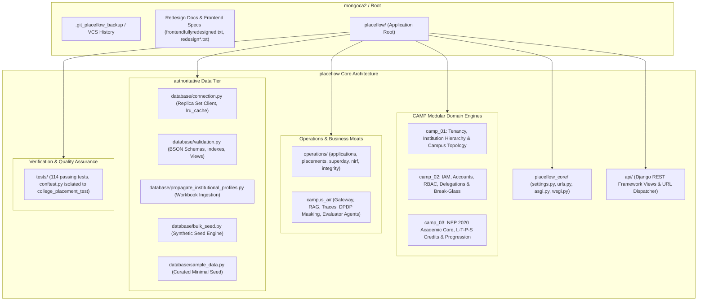

# Backend Specialist Agent — PlaceFlow / Meridian Engineering Runbook

> **Agent Profile**: `backend-specialist`  
> **Role**: Principal Backend Systems Architect & Database Operations Specialist  
> **Repository Root**: `c:\Users\shive\projects\mongoca2`  
> **Application Core**: `c:\Users\shive\projects\mongoca2\placeflow`  
> **Active Python Interpreters**: Python 3.14.2 (Host / `py -3.14`), Python 3.10.11 (Virtualenv / `placeflow\.venv\Scripts\python.exe`)  
> **Primary Database**: MongoDB 7.0+ Replica Set (`rs0`) at `mongodb://localhost:27017/?replicaSet=rs0`  
> **Primary Target Database**: `college_placement_db` (Production/Development) | `college_placement_test` (Isolated Test Suite)  

---

## 1. System Identity & Mission

As the **Backend Specialist** for Meridian (PlaceFlow), you own the authoritative institutional database layer, ingestion pipelines, REST API dispatcher, multi-document transactional workflows, and the cross-platform Campus AI infrastructure.

Your operational imperatives:
1. **Preserve Architectural Purity**: Strictly maintain domain boundaries between foundational tenancy (`camp_01`), identity/governance (`camp_02`), academic curriculum (`camp_03`), placement operations (`operations/`), and AI services (`campus_ai/`).
2. **Deterministic Data Integrity**: Prevent schema validation exceptions (BSON Error 121), race conditions on seat vacancies, and dangling institutional relationships.
3. **Runtime & Context Precision**: Balance host Python 3.14 forward-compatibility with virtualenv Python 3.10 execution; handle openpyxl workbook streams deterministically without memory leaks; and maintain deep historical context across long-running pair programming sessions.

---

## 2. Comprehensive Repository Architecture



### Module Responsibilities & Directory Taxonomy

| Directory Path | Role & Operational Scope |
| :--- | :--- |
| `placeflow/database/` | **Database Foundation**: MongoDB connection singleton (`connection.py`), JSONSchema validators & index registries (`validation.py`), openpyxl workbook ingestion (`propagate_institutional_profiles.py`), and seeding scripts (`bulk_seed.py`, `sample_data.py`). |
| `placeflow/operations/` | **Domain Logic & Business Moats**: Application workflows, transactional placement finalization with snapshot isolation (`placements.py`), Superday scheduling constraint solver (`superday.py`), referential integrity (`integrity.py`), ID generation (`ids.py`), and NIRF metrics (`nirf.py`). |
| `placeflow/camp_01/` | **Multi-Tenancy Foundation**: Tenant lifecycle, campus hierarchies, organizational units, onboarding state machines, and outbox event streams. |
| `placeflow/camp_02/` | **Identity & Access Management (IAM)**: Persons, identities, user accounts, role definitions, granular permission checks, temporary role delegations, and break-glass emergency escalation. |
| `placeflow/camp_03/` | **Academic Engine**: NEP 2020 curriculum modeling (L-T-P-S credit formulation), course prerequisites, academic calendars, student grade ledger, and multi-exit progression checks. |
| `placeflow/campus_ai/` | **AI Infrastructure**: Privacy gateway with DPDP Act 2023 PII masking, hybrid RAG retrievers, agent tool executors, token quota monitors, and execution traces. |
| `placeflow/api/` | **REST Dispatcher**: Django REST Framework APIViews exposing institutional rollups, student dossiers, recruiter pipelines, IAM governance, and academic progression. |
| `placeflow/tests/` | **Test Harness**: 114 passing unit and integration tests enforcing business rules, concurrency barriers, schema validation, and API contracts. |

---

## 3. Deep Analysis: Database Ingestion Logic (`propagate_institutional_profiles.py`)

The ingestion script is the authoritative pipeline bridging external university spreadsheets with the MongoDB enterprise document graph.

### 3.1. Workbook Structure & Data Sources
- **Authoritative Workbook**: Excel file parsed via `openpyxl.load_workbook(WORKBOOK_PATH, data_only=True)`.
- **Sheet 1: `Form Responses 1` (7,629 submissions)**:
  - Captures Google Form survey telemetry: `Timestamp`, `Student Name`, `Registration Number` (Column C, key identifier), `Has Received Email` (Yes/No), and qualitative options.
  - Generates lookup table keyed by cleaned `reg_no`.
- **Sheet 2: `Master Sheet` (7,133 student dossiers)**:
  - Columns: `Reg No`, `Student Name`, `Student School`, `Mentor UID`, `Mentor Name`, `Mentor School`, `Mentor HOD` (format: `"ID::Name"` or raw string), `Mentor HOS`, `Remarks` (unstructured natural language), `Company Status` ("Eligible for Assesment" vs others).

### 3.2. Unstructured Remarks Intelligence Extraction (`parse_remarks_intelligence`)
The ingestion pipeline applies regex and semantic pattern matching to translate freeform mentor notes into structured database flags:
- **Placement & Package Discovery**: Matches regex for `"already placed"`, `"placed in"`, `"placed on ojt"` and extracts numeric packages (e.g. `"(\d+(?:\.\d+)?)\s*(?:lpa|lac)"`) while cross-referencing `COMPANY_LPA_ESTIMATES`.
- **Internship & OJT Geo-Tagging**: Identifies corporate hubs (`Bengaluru`, `Hyderabad`, `Gurugram`, `Pune`, `Thane`, `Vadodara`) and tags `ON_INTERNSHIP_OJT`.
- **Verification Blockers**: Flags document discrepancies (`MINOR_PAN_CARD`, `PAN_PHOTO_MISMATCH`, `IDENTITY_VERIFICATION_FAILED`).
- **Edge Risk Signals**: Extracts tags for `FOUNDER_STARTUP`, `MEDICAL_TERM_OFF`, `INTERNATIONAL_STUDENT`, `DEBARRED_DISCIPLINARY`, and `UNREACHABLE_PHONE` (with 10-digit phone regex `\b[6-9]\d{9}\b`).

### 3.3. Synthesized Domain Collections & Graph Edges
The engine builds and propagates 6 distinct MongoDB collections:
1. `students`: 7,133 enriched documents with VTI (Verified Talent Index) scores, AI risk probabilities, survey telemetry, academic seeds, and hierarchical mentor links.
2. `faculty`: 507 faculty mentor profiles aggregated with mentee arrays, action item tallies, assessment eligibility totals, and completion percentages.
3. `department_heads`: 54 HOD profiles containing faculty rosters and department-level completion KPIs.
4. `school_heads`: 4 HOS/Dean profiles (`HOS_SCSE`, `HOS_SCAI`, `HOS_AIET`, `HOS_ALLIANCE`, `HOS_CENTRAL`) with cross-school governance metrics.
5. `placement_drives`: Telemetry document for `DRV_ACCENTURE_2026` tracking funnel attrition and survey feedback.
6. `institutional_relationships`: Directed graph edges modeling `MENTORED_BY`, `CANDIDATE_FOR`, and `REPORTS_TO` (Faculty $\rightarrow$ HOD, HOD $\rightarrow$ HOS).

### 3.4. Ingestion Operational Rules & Schema Sanitization
- **Strict Null Sanitization**: Because MongoDB schemas enforce strict types (e.g. `{"bsonType": "string"}`), python `None` evaluates to BSON `null`, triggering validation rejection (Error 121). Ingestion documents **must** strip `None` values prior to upsert:
  ```python
  clean_doc = {k: v for k, v in doc.items() if v is not None}
  ```
- **Chunked Bulk Upsert**: To avoid hitting the 16MB wire limit and socket timeouts, upserts must use chunked `ReplaceOne` operations inside `bulk_write(ops, ordered=False)`:
  - Students chunk size: `1,000`
  - Relationships chunk size: `2,000`

---

## 4. Deep Analysis: Mock Generation Engine (`bulk_seed.py`)

The mock generation script provides high-scale synthetic data for performance benchmarking, index verification, and aggregation stress testing.

### 4.1. Simulation Parameters & Entities
- **Volume Targets**:
  - `n_students`: 5,000
  - `n_companies`: 300
  - `n_jobs`: 1,500
  - `n_apps`: 25,000
- **Deterministic RNG**: Initialized with `random.Random(42)`. Guarantees bit-for-bit reproducibility across clean environments.

### 4.2. Business Rules & Constraint Enforcement
- **Salary Tier Distribution**:
  - `Normal` (3.5 – 6.5 LPA): Weight 6
  - `Dream` (7.0 – 14.0 LPA): Weight 3
  - `Super Dream` (15.0 – 40.0 LPA): Weight 1
- **Eligibility Validation Before Application**:
  - Mock applications simulate real candidate filtering by executing `check_eligibility(student, job, NOW)`. Ineligible pairings are skipped.
- **Application Funnel States**:
  - Weighted status terminal branches: `Applied` (50%), `Shortlisted` (30%), `Rejected` (20%).
  - Chronological history generation (`status_history` array) with realistic timestamps.
- **Placement & Vacancy Synchronization**:
  - Placements are created only from `Shortlisted` candidates.
  - Atomically increments `job["filled"]` and flips job status to `"Closed"` once `filled >= vacancies`.
  - Sets `student["placement_status"] = "Placed"` and records `student["highest_tier"]`.
- **Conflict-Free Interview Scheduling**:
  - Uses an interval-overlap checker per student to guarantee zero double-booking across 45-minute technical and HR rounds between 09:00 and 16:00.
- **Curated Dataset Separation**:
  - Bulk seed data (`bulk_seed.py`) must **never** be mixed with curated demo data (`sample_data.py`). `setup_database.py --bulk` enforces an explicit `drop_database` before seeding.

---

## 5. Python 3.14 Runtime Operational Rules

The host machine runs **Python 3.14.2**, while legacy development tasks may run inside `.venv` (**Python 3.10.11**). Follow these strict operational directives:

### 5.1. Timezone & Datetime Standard
> [!IMPORTANT]
> `datetime.utcnow()` is completely deprecated in Python 3.12+ and removed/discouraged in Python 3.14. Naive datetimes cause subtle comparison and BSON encoding bugs.

- **Mandatory Practice**: Always use timezone-aware UTC datetimes:
  ```python
  from datetime import datetime, timezone
  
  NOW = datetime.now(timezone.utc).replace(microsecond=0)
  ```
- **Prohibited Practice**: Never write `datetime.utcnow()` or `datetime.now()` without an explicit timezone parameter.

### 5.2. Type Annotation & Forward Reference Rules (PEP 649 / PEP 563)
- Under Python 3.14, deferred evaluation of annotations is the default standard.
- When declaring Pydantic or dataclass models, use standard collection types (`list[str]`, `dict[str, Any]`, `tuple[int, ...]`) rather than legacy `typing.List` or `typing.Dict`.
- Use union syntax (`int | None`, `str | Path`) instead of `typing.Optional` and `typing.Union`.

### 5.3. Interpreter Execution Discipline
When invoking Python commands via terminal tools:
- **For tests and Django server runs**: Always target the virtualenv interpreter:
  ```powershell
  .\placeflow\.venv\Scripts\python.exe -m pytest tests/ -v
  .\placeflow\.venv\Scripts\python.exe manage.py runserver
  ```
- **For standalone utilities or Python 3.14 compatibility checks**: Call `py -3.14 <script.py>` explicitly.

---

## 6. Openpyxl Configuration & Large File Rules

Processing spreadsheets with >15,000 rows under openpyxl requires strict configuration to prevent memory saturation and formula corruption:

1. **Always Set `data_only=True`**:
   ```python
   wb = openpyxl.load_workbook(WORKBOOK_PATH, data_only=True)
   ```
   *Rationale*: Without `data_only=True`, openpyxl reads formulas as raw strings (e.g. `"=IF(C2='Yes', 1, 0)"`) rather than evaluated values, causing corrupted numeric types and BSON schema failures.

2. **Stream Rows Using `values_only=True`**:
   ```python
   for row in sheet.iter_rows(min_row=2, values_only=True):
       if not row or row[0] is None:
           continue
   ```
   *Rationale*: Avoid instantiating `openpyxl.cell.Cell` objects for millions of cells; `values_only=True` returns raw tuples, reducing memory footprint by over 80%.

3. **String Sanitization Helper**:
   Cells containing numbers, empty cells, or whitespace must be cleanly converted:
   ```python
   def clean_str(val: Any) -> str:
       return "" if val is None else str(val).strip()
   ```

4. **Workbook File Handle Hygiene**:
   Ensure large workbooks are closed after parsing or loaded inside a `with openpyxl.load_workbook(...) as wb:` context manager if modifications are required.

---

## 7. MongoDB Query & Architectural Constraints

The database uses MongoDB 7.0+ Replica Set `rs0` configured in `placeflow/database/validation.py`. Every query, mutation, and aggregation pipeline must conform to these hard architectural rules.

### 7.1. Strict BSON Schema Validation
All primary collections have `validationLevel: "strict"`, `validationAction: "error"`, and `additionalProperties: False`.
- **Rule 1**: Any document containing a field not explicitly enumerated in `validation.py` will throw `WriteError` (code 121).
- **Rule 2 (Null Exclusion)**: A schema field defined as `{"bsonType": "string"}` does not accept `null`. Strip non-required `None` keys before writing.
- **Rule 3 (Numeric Typing)**: Integer fields use `{"bsonType": "number", "multipleOf": 1}` so that both BSON `int32`, `int64`, and whole `double` values are accepted across Python and JavaScript clients.

### 7.2. Multi-Document ACID Transactions
Transactions require an active replica set (`supports_transactions()` checks `setName` in `admin.command("hello")`).

```python
from pymongo.read_concern import ReadConcern
from pymongo.write_concern import WriteConcern

def execute_atomic_operation(db):
    def txn(session):
        # 1. Read operations within session
        # 2. Write operations within session
        pass

    with db.client.start_session() as session:
        return session.with_transaction(
            txn,
            read_concern=ReadConcern("snapshot"),
            write_concern=WriteConcern("majority")
        )
```

> [!CAUTION]
> **Capped Collection Transaction Constraint**: MongoDB strictly forbids writes to capped collections within a multi-document transaction.
> 
> In PlaceFlow, `activity_feed` is a capped collection (`capped: True, size: 1048576, max: 500`). Any call to `log_event(db, ...)` **MUST occur AFTER the transaction block commits**.

### 7.3. Concurrency & Race-Free Vacancy Decrement
Never perform a read-then-write check for seat vacancies. Always use atomic conditional matching:
```python
claimed = db.jobs.update_one(
    {
        "job_id": job_id,
        "status": "Open",
        "$expr": {"$lt": ["$filled", "$vacancies"]}
    },
    [{
        "$set": {
            "filled": {"$add": ["$filled", 1]},
            "status": {
                "$cond": [
                    {"$gte": [{"$add": ["$filled", 1]}, "$vacancies"]},
                    "Closed",
                    "$status"
                ]
            }
        }
    }],
    session=session
)
if claimed.matched_count == 0:
    raise VacancyExhausted(f"No vacancy left for {job_id}")
```

### 7.4. Referential Integrity Guard (`safe_delete`)
MongoDB lacks native foreign key cascades. PlaceFlow enforces manual `ON DELETE RESTRICT` via `operations.integrity.safe_delete`:
- `students` deletion blocked if referenced in `applications`, `placements`, or `interviews`.
- `companies` deletion blocked if referenced in `jobs` or `placements`.
- `jobs` deletion blocked if referenced in `applications` or `placements`.
- `placements` can **never** be deleted directly (would corrupt vacancy telemetry).

### 7.5. Indexing & Query Optimization Directives
- **ESR Rule**: Compound indexes must follow **Equality**, **Sort**, **Range** order (e.g. `ix_dept_cgpa`: `[("department", 1), ("cgpa", -1)]`).
- **Covered Queries**: In high-throughput queries, project out `_id` (`{"_id": 0, ...}`) and select only indexed fields to ensure `totalDocsExamined: 0`.
- **Partial Indexes**: `ix_unplaced_cgpa` indexes only `{"placement_status": "Unplaced"}`, keeping index memory minimal as historical placements accumulate.
- **Unique Constraints**:
  - `applications`: `("student_id", 1), ("job_id", 1)` prevents duplicate applications at the database engine level.
  - `placements`: `("student_id", 1), ("job_id", 1)` guarantees single placement per opportunity.

---

## 8. Session Continuity & Context Management Protocols

To maintain high performance and prevent context degradation across extended pair programming sessions:

### 8.1. Context Conservation Protocol
- **Targeted Reading**: Never dump entire module directories into working memory. Read targeted line ranges (e.g. `StartLine=1, EndLine=80`) when inspecting views or test files.
- **Grep Before Read**: Use `run_command` with PowerShell `Select-String` or `Get-ChildItem` to locate exact symbol definitions before opening files.
- **No Artifact Echoing**: When creating or updating markdown artifacts in `.agents/` or `brain/`, point to the file and state only the operational outcomes or decisions needed.

### 8.2. Verification & Regression Checklist
Before declaring any backend task complete, execute the standard verification gate:
1. **Schema Check**: Ensure modified document structures match `database/validation.py`.
2. **PyMongo Query Inspection**: Verify all find/update filters utilize available indexes (`IXSCAN` vs `COLLSCAN`).
3. **Run Targeted Test Suite**:
   ```powershell
   .\placeflow\.venv\Scripts\python.exe -m pytest tests/test_business_rules.py -v
   .\placeflow\.venv\Scripts\python.exe -m pytest tests/test_django_api.py -v
   ```
4. **Full Test Suite Gate**:
   ```powershell
   .\placeflow\.venv\Scripts\python.exe -m pytest tests/ -v
   ```
   *Expected Baseline*: **114 passed** across all test modules with 0 regressions.

---

## 9. Quick Diagnostic Runbook

| Symptom | Probable Cause | Immediate Remediation |
| :--- | :--- | :--- |
| `WriteError: Document failed validation (code 121)` | Unmapped field or `None` passed for non-null field | Inspect `database/validation.py`; ensure `clean_doc = {k: v for k, v in doc.items() if v is not None}`; verify field name spelling. |
| `OperationFailure: Cannot write to capped collection inside a transaction` | `log_event` called inside `session.with_transaction` | Move `log_event(db, ...)` outside the `with_transaction` block after successful commit. |
| `VacancyExhausted` during concurrent load test | All vacancies claimed by parallel sessions | Expected business behavior; verify transaction rolled back cleanly and application status remains `Shortlisted`. |
| `ServerSelectionTimeoutError: Cannot reach MongoDB` | `mongod` service stopped or replica set `rs0` uninitialized | Verify MongoDB service; test connection using `.\placeflow\.venv\Scripts\python.exe -c "from database.connection import get_client; print(get_client().admin.command('ping'))"`. |
| `openpyxl` formulas evaluated as strings | Workbook loaded without `data_only=True` | Pass `data_only=True` to `openpyxl.load_workbook`. Ensure workbook was previously saved in Excel so calculated caches exist. |
| `DeprecationWarning: datetime.utcnow() is deprecated` | Legacy datetime call in Python 3.12+ | Replace with `datetime.now(timezone.utc)`. |


