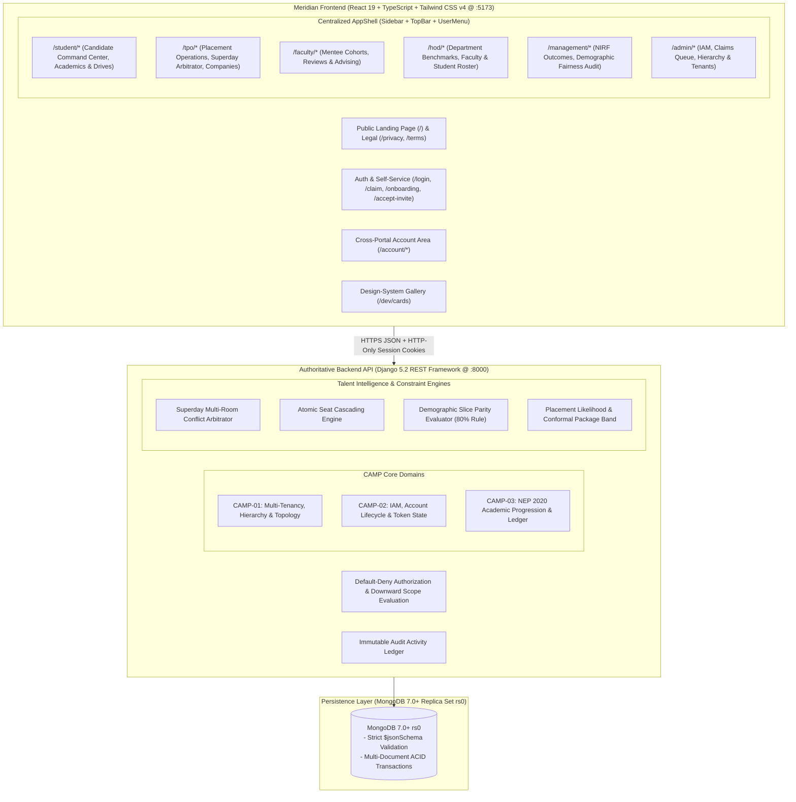
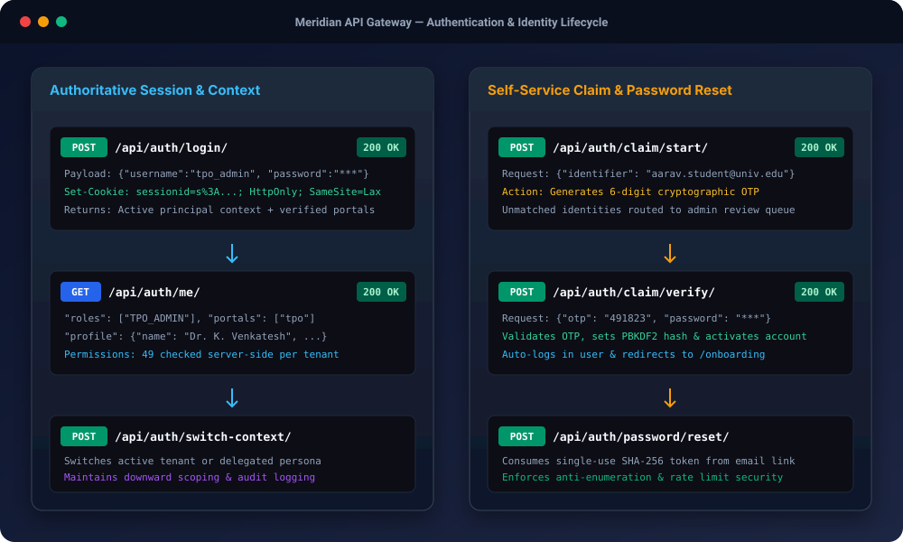
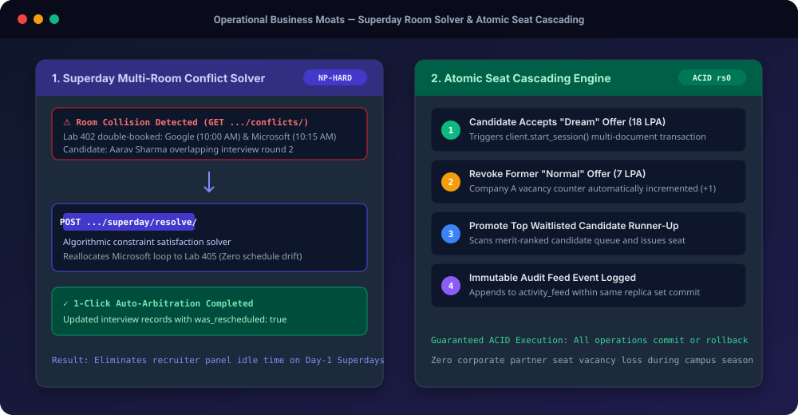

# Meridian — The Institutional Academic & Career Operating System

<div align="center">


### Role-Partitioned Workspaces &bull; In-Process Talent ML &bull; MongoDB 7.0+ Replica Set Transactions &bull; Default-Deny Server-Side RBAC

[](https://www.python.org/)
[](https://www.djangoproject.com/)
[](https://react.dev/)
[](https://tailwindcss.com/)
[](https://www.mongodb.com/)
[](https://docs.pytest.org/)
[](https://vitest.dev/)
[](http://127.0.0.1:8000/api/health/)
[](placeflow/frontend/src/public/PrivacyPolicyPage.tsx)

</div>

---

## 🎬 Live Platform Demo

<div align="center">


*Figure 1: Live workflow walkthrough: Public Landing &rarr; TPO Command Center &amp; Superday Room Solver &rarr; Student Workspace &amp; 1-Click Apply &rarr; Executive Management Demographic Slice Fairness Audit.*

</div>

---

## 🏛️ Platform Architecture



---

## 🚀 Key Highlights & Architectural Moats

### 1. Six Purpose-Built Role Workspaces

<div align="center">


*Figure 2: Architecture of the 6 role-partitioned workspaces, showing key endpoints, permissions, and architectural boundaries.*

</div>

No shared "chameleon" pages. Meridian enforces clean architectural boundaries:
- 🎓 **Student Portal**: Real-time course registrations, prerequisite gap analyzers, one-click drive applications, interview rounds, and DPDP consent controls.
- 🏢 **TPO Directorate**: 6-step Placement Drive creation wizard, real-time candidate estimators, corporate partner CRM, and 1-click Superday conflict arbitration.
- 🧑‍🏫 **Faculty Advisory**: Assigned mentee roster, attendance tracking, CIE score monitoring, and academic intervention notes.
- 🏛️ **HOD Department Leadership**: Department placement rates, student cohort tracking, faculty load allocations, and academic progression reviews.
- 📊 **Executive Management**: Official NIRF accreditation metrics (GPH/GMS calculation), campus-wide demographic fairness audit, and autonomous copilot execution logs.
- 🛡️ **Institutional Admin**: Tenant and campus hierarchy configuration, IAM identities, user accounts, and manual account claims resolution queue.

### 2. Design-System Cards with 5 Deterministic States

<div align="center">


*Figure 3: Dynamic field-level privacy masking evaluated server-side when viewing peer candidate records vs. faculty/staff.*

</div>

Every card in the system (`ProfileCard`, `DriveCard`, `ApplicationCard`, `InterviewCard`, `OfferCard`, `CompanyCard`, `TaskCard`) strictly supports:
- `Default`: Complete data presentation with interactive triggers.
- `Loading`: Pulse-animated skeleton matching exact layout dimensions.
- `Empty`: Descriptive explanation with actionable next steps.
- `Error`: Inline error state with retry triggers.
- `Masked`: Field-level privacy obfuscation for unauthorized viewers under DPDP regulations.

### 3. Server-Side Default-Deny RBAC &amp; Account Lifecycle

<div align="center">



*Figure 4: Authoritative session authentication flow, cryptographic claim token dispatch, and self-service password recovery.*

</div>

- Permissions are verified strictly on the server by DRF permission classes.
- Identity is derived entirely from validated session cookies, not client-side state.
- Scopes are enforced hierarchically: `PLATFORM` &rarr; `INSTITUTION` &rarr; `CAMPUS` &rarr; `ORGANIZATIONAL_UNIT` &rarr; `SELF`.

### 4. Operational Business Moats: Superday Solver &amp; Seat Cascading

<div align="center">



*Figure 5: Constraint solver resolving Superday room contention and ACID multi-document seat cascading transaction pipeline.*

</div>

---

## 📋 Comprehensive REST API Reference (83+ Endpoints)

| Category | Method | Endpoint | Auth Required | Description |
| :--- | :---: | :--- | :--- | :--- |
| **System** | `GET` | `/api/health/` | Public | Service health & replica set probe |
| **Auth** | `GET` | `/api/auth/csrf/` | Public | Acquire CSRF session cookie |
| **Auth** | `POST` | `/api/auth/login/` | Public | Authenticate with username & password |
| **Auth** | `POST` | `/api/auth/logout/` | Authed | Invalidate session & clear cookies |
| **Auth** | `GET` | `/api/auth/me/` | Authed | Active principal context & verified profile |
| **Lifecycle** | `POST` | `/api/auth/password/forgot/` | Public | Enumeration-safe password reset trigger |
| **Lifecycle** | `POST` | `/api/auth/password/reset/` | Public | Cryptographic token password reset |
| **Lifecycle** | `POST` | `/api/auth/claim/start/` | Public | Start identity claim via institutional email OTP |
| **Lifecycle** | `POST` | `/api/auth/claim/verify/` | Public | Verify 6-digit OTP & activate account |
| **Lifecycle** | `POST` | `/api/auth/accept-invite/` | Public | Redeem invitation token & set password |
| **Account** | `GET, PATCH` | `/api/account/profile/` | Authed | View & update editable profile extensions |
| **Account** | `POST` | `/api/account/avatar/` | Authed | Multipart upload user avatar |
| **Account** | `GET, POST` | `/api/account/sessions/` | Authed | List active sessions & revoke session |
| **Account** | `GET, POST` | `/api/account/notifications/`| Authed | List notifications & mark as read |
| **People** | `GET` | `/api/people/<id>/card/` | Authed | Scoped person card with field-level masking |
| **Media** | `GET` | `/api/media/avatar/<id>/` | Authed | Stream validated binary avatar image |
| **Student** | `GET` | `/api/student/me/` | `portal.student` | Candidate context & mentor assignments |
| **Student** | `GET` | `/api/student/opportunities/`| `placement.drive.view` | Eligible job drives matching criteria |
| **Student** | `POST` | `/api/student/opportunities/<id>/apply/` | `placement.apply` | Submit job application with DPDP consent |
| **Student** | `GET` | `/api/student/applications/` | `placement.apply` | Application history & stage progress |
| **Student** | `GET` | `/api/student/interviews/` | `placement.apply` | Scheduled technical/HR interview rounds |
| **Student** | `GET` | `/api/student/offers/` | `placement.offer.view` | Received offers & package details |
| **Student** | `POST` | `/api/student/offers/<id>/respond/` | `placement.offer.respond` | Accept/reject offer (triggers seat cascading) |
| **Student** | `GET` | `/api/student/academics/` | `academic.record.view`| NEP 2020 course progression & CIE scores |
| **Student** | `GET, POST`| `/api/student/consents/` | `dpdp.consent.view` | DPDP 2023 purpose consent ledger |
| **Student** | `GET` | `/api/student/insights/readiness/` | `portal.student` | In-process ML placement likelihood score |
| **TPO** | `GET` | `/api/tpo/overview/` | `placement.overview.view` | Directorate placement rate & median CTC |
| **TPO** | `GET, POST` | `/api/tpo/jobs/` | `placement.drive.create`| Campus recruitment drives & wizard setup |
| **TPO** | `GET` | `/api/tpo/students/` | `student.roster.view` | Candidate roster with Verified Talent Index |
| **TPO** | `GET, POST` | `/api/tpo/companies/` | `company.partner.view` | Corporate partner directory & tier policies |
| **TPO** | `GET` | `/api/tpo/applications/` | `placement.application.view` | Global application ledger across drives |
| **TPO** | `GET` | `/api/tpo/interviews/` | `placement.interview.view`| Campus-wide interview schedules |
| **TPO** | `GET` | `/api/tpo/placements/` | `placement.offer.view` | Confirmed placements register |
| **TPO** | `GET, POST` | `/api/tpo/superday/` | `superday.arbitrate` | Detect & 1-click resolve room conflicts |
| **TPO** | `GET` | `/api/tpo/insights/renege/` | `renege.radar.view` | Post-offer candidate renege flight radar |
| **TPO** | `GET` | `/api/tpo/models/` | `models.registry.view` | Placement ML models versioning & latency |
| **Faculty** | `GET` | `/api/faculty/mentees/` | `faculty.mentees.view` | Assigned mentee cohort with attendance flags |
| **Faculty** | `GET` | `/api/faculty/summary/` | `faculty.mentees.view` | Mentorship cohort progression summary |
| **HOD** | `GET` | `/api/hod/students/` | `hod.students.view` | Department student cohort |
| **HOD** | `GET` | `/api/hod/faculty/` | `hod.faculty.view` | Department faculty roster & mentoring loads |
| **HOD** | `GET` | `/api/hod/summary/` | `hod.summary.view` | Department placement rate & year benchmarks |
| **Management**| `GET` | `/api/management/nirf/metrics/` | `accreditation.nirf.view` | NIRF GPH & GMS accreditation metrics |
| **Management**| `GET` | `/api/management/fairness/audit/` | `agent.fairness.audit` | Disparate impact fairness audit (7,141 cohort) |
| **Management**| `GET` | `/api/management/agents/runs/` | `campus.ai.audit` | Autonomous Copilot execution ledger |
| **Admin** | `GET` | `/api/admin/tenants/` | `tenant.manage` | Platform multi-tenant registry |
| **Admin** | `GET` | `/api/admin/institutions/` | `institution.manage` | Institutional entities & campus mapping |
| **Admin** | `GET, POST` | `/api/admin/claims/` | `iam.account.create` | Pending manual account verification queue |
| **Admin** | `GET` | `/api/admin/iam/identities/` | `iam.view` | Person identity catalogue (CAMP-02) |
| **Admin** | `GET` | `/api/admin/iam/accounts/` | `iam.view` | User accounts registry |
| **Admin** | `GET` | `/api/admin/iam/roles/` | `iam.roles.view` | System RBAC roles & permissions catalogue |

---

## 🔑 Seeded Demo Credentials (DEBUG Mode)

All accounts share the default development password: **`password123`**

```
┌───────────────────┬──────────────────────┬──────────────────────┬─────────────────────────┐
│ Username          │ Baseline Role        │ Scoped Unit          │ Primary Portal Route    │
├───────────────────┼──────────────────────┼──────────────────────┼─────────────────────────┤
│ student           │ STUDENT_MEMBER       │ STU001 (Self)        │ /student                │
│ placement_rep     │ PLACEMENT_REP        │ OU_CSE (Department)  │ /student                │
│ faculty           │ FACULTY_MENTOR       │ OU_CSE (Department)  │ /faculty                │
│ coordinator       │ DEPT_COORDINATOR     │ OU_CSE (Department)  │ /faculty                │
│ hod               │ DEPARTMENT_HEAD      │ OU_CSE (Department)  │ /hod                    │
│ dean              │ SCHOOL_HEAD          │ CMP_MAIN (Campus)    │ /hod                    │
│ tpo_coordinator   │ TPO_COORDINATOR      │ CMP_MAIN (Campus)    │ /tpo                    │
│ tpo_admin         │ TPO_ADMIN            │ INSTITUTION          │ /tpo                    │
│ vice_chancellor   │ INSTITUTION_HEAD     │ INSTITUTION          │ /management             │
│ admin             │ INSTITUTION_ADMIN    │ INSTITUTION          │ /admin                  │
│ superadmin        │ SUPER_ADMIN          │ GLOBAL               │ /admin                  │
│ auditor           │ AUDITOR              │ INSTITUTION          │ /management             │
│ recruiter         │ RECRUITER_EXTERNAL   │ COMP001 (Accenture)  │ /tpo                    │
└───────────────────┴──────────────────────┴──────────────────────┴─────────────────────────┘
```

---

## 🛠️ Verification Commands

```powershell
# 1. Architecture Boundaries (Zero cross-portal imports)
cd placeflow/frontend; node scripts/check-boundaries.mjs

# 2. Frontend Build & Vitest Unit Tests
cd placeflow/frontend; npm run build; npm test -- --run

# 3. Backend Automated Pytest Suite
$env:PYTHONPATH="placeflow"; & placeflow\.venv\Scripts\python.exe -m pytest -q

# 4. Live Endpoint Verification (83 / 83 Verified)
& placeflow\.venv\Scripts\python.exe .\.gemini\antigravity\brain\7b696f20-c376-403b-815c-ef08a7d26f4a\scratch\verify_all_endpoints.py
```

---

<div align="center">

**Meridian Institutional Systems** &bull; [placeflow/](placeflow/)  
*Verifiable Academic & Career Excellence.*

</div>
