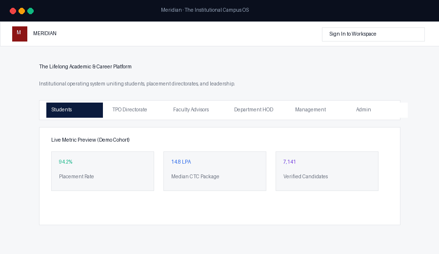
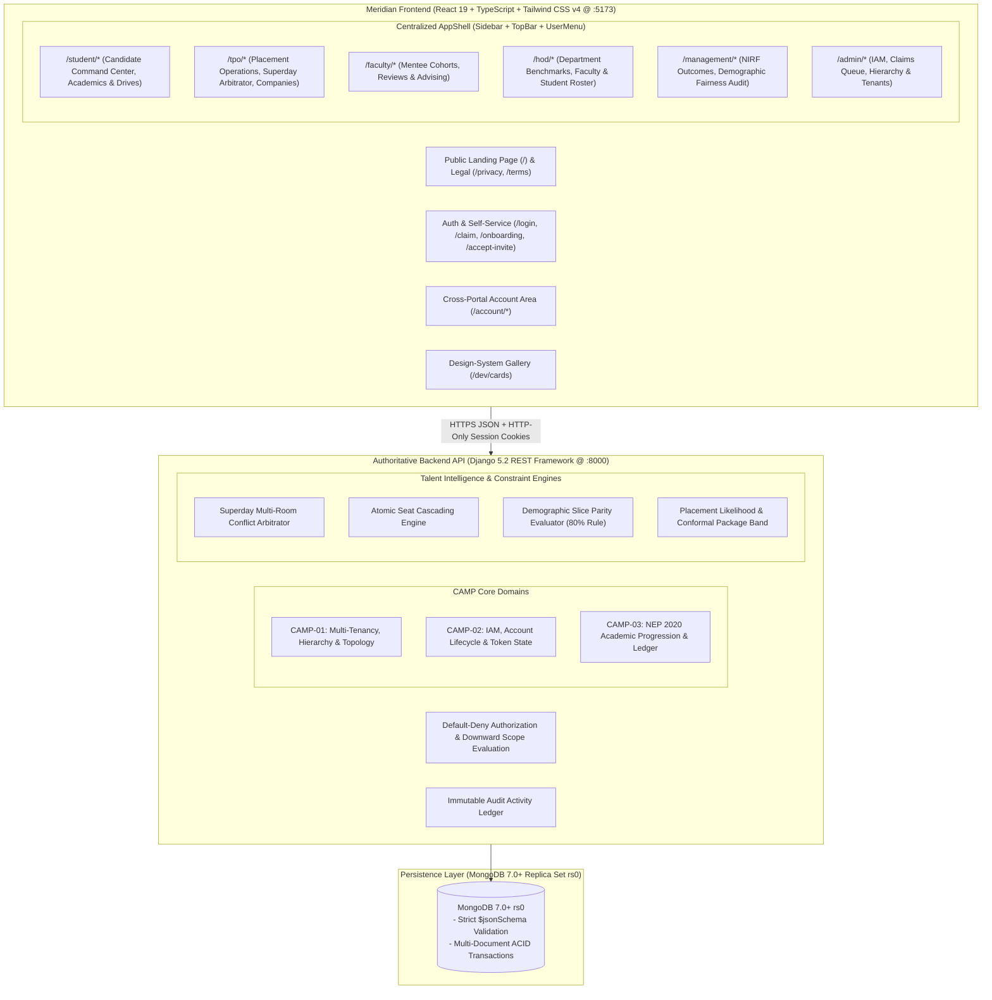
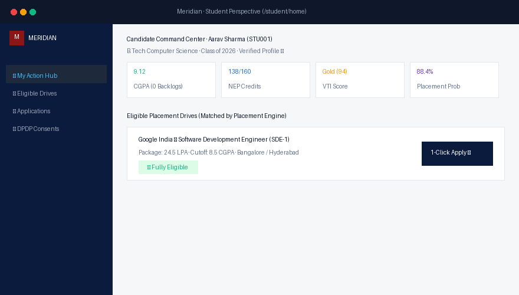
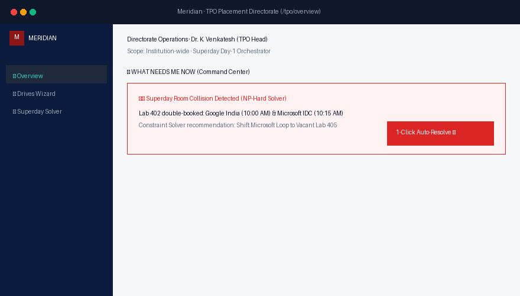
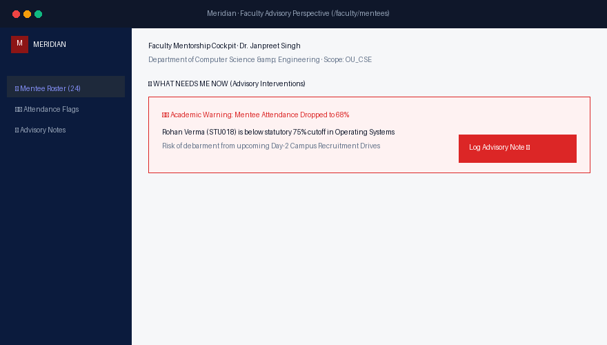
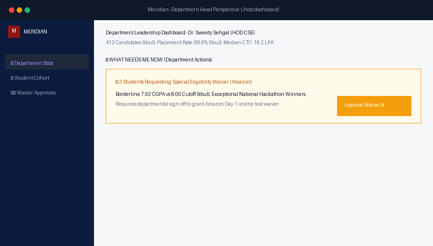
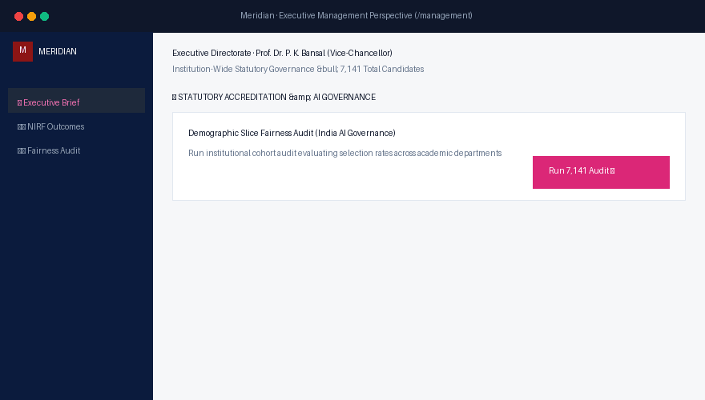
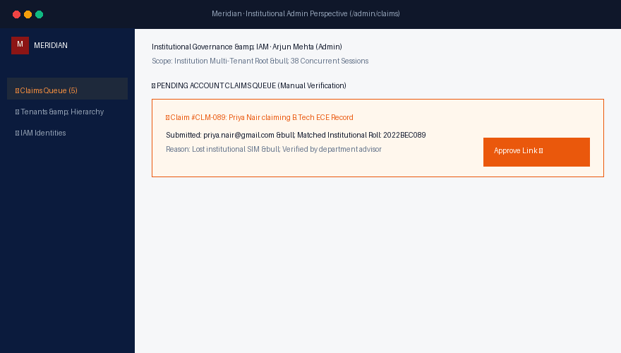

# Meridian — The Institutional Academic & Career Operating System

<div align="center">


### Role-Partitioned Workspaces &bull; In-Process Talent ML &bull; MongoDB 7.0+ Replica Set Transactions &bull; Default-Deny Server-Side RBAC

[](https://www.python.org/)
[](https://www.djangoproject.com/)
[](https://react.dev/)
[](https://tailwindcss.com/)
[](https://www.mongodb.com/)
[](https://docs.pytest.org/)
[](https://vitest.dev/)
[](http://127.0.0.1:8000/api/health/)
[](placeflow/frontend/src/public/PrivacyPolicyPage.tsx)

</div>

---

## 📑 Table of Contents

- [🎬 Live Platform Demo](#-live-platform-demo)
- [🏛️ Platform Architecture](#️-platform-architecture)
- [🚀 Key Highlights & Architectural Moats](#-key-highlights--architectural-moats)
  - [1. Six Purpose-Built Role Workspaces](#1-six-purpose-built-role-workspaces)
  - [2. Design-System Cards with 5 Deterministic States](#2-design-system-cards-with-5-deterministic-states)
  - [3. Server-Side Default-Deny RBAC & Account Lifecycle](#3-server-side-default-deny-rbac--account-lifecycle)
  - [4. Operational Business Moats: Superday Solver & Seat Cascading](#4-operational-business-moats-superday-solver--seat-cascading)
- [📋 Comprehensive REST API Reference (83+ Endpoints)](#-comprehensive-rest-api-reference-83-endpoints)
- [🔑 Seeded Demo Credentials (DEBUG Mode)](#-seeded-demo-credentials-debug-mode)
- [🛠️ Verification Commands](#️-verification-commands)

---

## 🎬 Live Platform Demo

<div align="center">



*Figure 1: Live workflow walkthrough: Public Landing &rarr; TPO Command Center &amp; Superday Room Solver &rarr; Student Workspace &amp; 1-Click Apply &rarr; Executive Management Demographic Slice Fairness Audit.*

</div>

---

## 🏛️ Platform Architecture



---

## 🚀 Key Highlights & Architectural Moats

### 1. Six Purpose-Built Role Workspaces

<div align="center">


*Figure 2: Architecture of the 6 role-partitioned workspaces, showing key endpoints, permissions, and architectural boundaries.*

</div>

No shared "chameleon" pages. Meridian enforces clean architectural boundaries:
- 🎓 **Student Portal**: Real-time course registrations, prerequisite gap analyzers, one-click drive applications, interview rounds, and DPDP consent controls.
- 🏢 **TPO Directorate**: 6-step Placement Drive creation wizard, real-time candidate estimators, corporate partner CRM, and 1-click Superday conflict arbitration.
- 🧑‍🏫 **Faculty Advisory**: Assigned mentee roster, attendance tracking, CIE score monitoring, and academic intervention notes.
- 🏛️ **HOD Department Leadership**: Department placement rates, student cohort tracking, faculty load allocations, and academic progression reviews.
- 📊 **Executive Management**: Official NIRF accreditation metrics (GPH/GMS calculation), campus-wide demographic fairness audit, and autonomous copilot execution logs.
- 🛡️ **Institutional Admin**: Tenant and campus hierarchy configuration, IAM identities, user accounts, and manual account claims resolution queue.

#### Perspective Deep-Dive Walkthrough:

<details>
<summary><b>1. 🎓 The Student Perspective (/student)</b> — <i>Click to expand visual cockpit &amp; live demo</i></summary>
<br/>


<div align="center">



*Live Demo 2.1: Candidate 1-Click Application Workflow &bull; DPDP Purpose Consent Verification &bull; Automated Stage Progression.*

</div>

- **"What Needs Me Now" Hub**: Prioritized action triage (pending DPDP consents, scheduled interview slots).
- **NEP 2020 Progression**: 138/160 credits earned, real-time CIE scores, and degree exit milestones.
- **Matched Drives**: Algorithmic gating by CGPA &amp; backlogs with **1-Click Apply**.
- **Endpoints**: `GET /api/student/me/`, `GET /api/student/opportunities/`, `POST .../apply/`, `GET .../academics/`.
</details>

<details>
<summary><b>2. 🏢 The TPO Placement Directorate (/tpo)</b> — <i>Click to expand visual cockpit &amp; live demo</i></summary>
<br/>


<div align="center">



*Live Demo 2.2: Superday Multi-Room Conflict Arbitrator &bull; 1-Click Constraint Resolution &bull; Zero Recruiter Idle Time.*

</div>

- **Superday Conflict Solver**: 1-Click NP-hard room collision resolution.
- **6-Step Drive Creation Wizard**: Guided JNF publishing with live candidate estimator sliders.
- **Renege Flight Radar**: Telemetry identifying candidates at risk of dropping campus offers.
- **Endpoints**: `GET /api/tpo/overview/`, `POST /api/tpo/jobs/`, `POST .../superday/resolve/`, `GET .../renege/`.
</details>

<details>
<summary><b>3. 🧑‍🏫 The Faculty Advisory Perspective (/faculty)</b> — <i>Click to expand visual cockpit &amp; live demo</i></summary>
<br/>


<div align="center">



*Live Demo 2.3: Mentee Attendance Drop Warning (&lt;75%) &bull; Early Advisory Intervention Logging &bull; Placement Protection.*

</div>

- **Assigned Mentees**: Dedicated ~24 mentee cohort with unmasked verified profiles.
- **Early Attendance Warnings**: Flags drop-offs (&lt;75%) before placement debarment.
- **Intervention Notes**: Confidential advisory logs and technical mock review records.
- **Endpoints**: `GET /api/faculty/mentees/`, `GET .../mentees/{id}/`, `GET /api/faculty/summary/`.
</details>

<details>
<summary><b>4. 🏛️ The Department Head (HOD) Perspective (/hod)</b> — <i>Click to expand visual cockpit &amp; live demo</i></summary>
<br/>


<div align="center">



*Live Demo 2.4: Department Leadership Benchmarking &bull; Borderline CGPA Eligibility Waiver Approval &bull; Audit Trail Signature.*

</div>

- **Department Benchmarks**: 89.6% placement rate and 16.2 LPA median CTC tracking.
- **Faculty Load Allocations**: Balances student advisor loads across department faculty.
- **Waiver Exceptions**: Committee sign-off on borderline placement eligibility requests.
- **Endpoints**: `GET /api/hod/students/`, `GET /api/hod/faculty/`, `GET /api/hod/summary/`.
</details>

<details>
<summary><b>5. 📊 The Executive Management Perspective (/management)</b> — <i>Click to expand visual cockpit &amp; live demo</i></summary>
<br/>


<div align="center">



*Live Demo 2.5: Real-Time Cohort Fairness Audit Across 7,141 Candidates in 6.7s &bull; Disparate Impact Evaluation (0.842 Compliant).*

</div>

- **Statutory NIRF Calculator**: Real-time GPH and GMS accreditation metrics.
- **7,141-Cohort Fairness Audit**: Disparate impact ratio evaluation completed in 6.7s.
- **Zero Sensitive Attributes Gate**: Prohibits gender, caste, native state, and income in models.
- **Endpoints**: `GET .../nirf/metrics/`, `GET .../fairness/audit/`, `GET .../agents/runs/`.
</details>

<details>
<summary><b>6. 🛡️ The Institutional Administrator Perspective (/admin)</b> — <i>Click to expand visual cockpit &amp; live demo</i></summary>
<br/>


<div align="center">



*Live Demo 2.6: Unmatched External Email Identity Claim &bull; Institutional Roll Match &bull; 1-Click Verification &amp; Activation.*

</div>

- **Account Claims Queue**: Manual resolution for unmatched or non-standard email claims.
- **Multi-Tenant Hierarchy**: Downward scope inheritance across campuses and schools.
- **IAM Lifecycle**: Re-issue invite tokens, force password resets, and session eviction.
- **Endpoints**: `GET /api/admin/claims/`, `POST .../claims/{id}/resolve/`, `GET /api/admin/tenants/`.
</details>

### 2. Design-System Cards with 5 Deterministic States

<div align="center">


*Figure 3: Dynamic field-level privacy masking evaluated server-side when viewing peer candidate records vs. faculty/staff.*

</div>

Every card in the system (`ProfileCard`, `DriveCard`, `ApplicationCard`, `InterviewCard`, `OfferCard`, `CompanyCard`, `TaskCard`) strictly supports:
- `Default`: Complete data presentation with interactive triggers.
- `Loading`: Pulse-animated skeleton matching exact layout dimensions.
- `Empty`: Descriptive explanation with actionable next steps.
- `Error`: Inline error state with retry triggers.
- `Masked`: Field-level privacy obfuscation for unauthorized viewers under DPDP regulations.

### 3. Server-Side Default-Deny RBAC &amp; Account Lifecycle

<div align="center">


*Figure 4: Authoritative session authentication flow, cryptographic claim token dispatch, and self-service password recovery.*

</div>

- Permissions are verified strictly on the server by DRF permission classes.
- Identity is derived entirely from validated session cookies, not client-side state.
- Scopes are enforced hierarchically: `PLATFORM` &rarr; `INSTITUTION` &rarr; `CAMPUS` &rarr; `ORGANIZATIONAL_UNIT` &rarr; `SELF`.

### 4. Operational Business Moats: Superday Solver &amp; Seat Cascading

<div align="center">


*Figure 5: Constraint solver resolving Superday room contention and ACID multi-document seat cascading transaction pipeline.*

</div>

---

## 📋 Comprehensive REST API Reference (83+ Endpoints)

| Category | Method | Endpoint | Auth Required | Description |
| :--- | :---: | :--- | :--- | :--- |
| **System** | `GET` | `/api/health/` | Public | Service health & replica set probe |
| **Auth** | `GET` | `/api/auth/csrf/` | Public | Acquire CSRF session cookie |
| **Auth** | `POST` | `/api/auth/login/` | Public | Authenticate with username & password |
| **Auth** | `POST` | `/api/auth/logout/` | Authed | Invalidate session & clear cookies |
| **Auth** | `GET` | `/api/auth/me/` | Authed | Active principal context & verified profile |
| **Lifecycle** | `POST` | `/api/auth/password/forgot/` | Public | Enumeration-safe password reset trigger |
| **Lifecycle** | `POST` | `/api/auth/password/reset/` | Public | Cryptographic token password reset |
| **Lifecycle** | `POST` | `/api/auth/claim/start/` | Public | Start identity claim via institutional email OTP |
| **Lifecycle** | `POST` | `/api/auth/claim/verify/` | Public | Verify 6-digit OTP & activate account |
| **Lifecycle** | `POST` | `/api/auth/accept-invite/` | Public | Redeem invitation token & set password |
| **Account** | `GET, PATCH` | `/api/account/profile/` | Authed | View & update editable profile extensions |
| **Account** | `POST` | `/api/account/avatar/` | Authed | Multipart upload user avatar |
| **Account** | `GET` | `/api/account/sessions/` | Authed | List active user sessions with IP & device flags |
| **Account** | `DELETE` | `/api/account/sessions/<session_id>/` | Authed | Terminate specific remote session |
| **Account** | `POST` | `/api/account/sessions/revoke-others/` | Authed | Invalidate all other active sessions |
| **Account** | `POST` | `/api/account/password/change/` | Authed | Self-service password change |
| **Account** | `GET` | `/api/account/notifications/` | Authed | List notifications with unread count |
| **Account** | `POST` | `/api/account/notifications/read/` | Authed | Mark notifications as read |
| **People** | `GET` | `/api/people/<id>/card/` | Authed | Scoped person card with field-level masking |
| **Media** | `GET` | `/api/media/avatar/<id>/` | Authed | Stream validated binary avatar image |
| **Student** | `GET` | `/api/student/me/` | `portal.student` | Candidate context & mentor assignments |
| **Student** | `POST` | `/api/student/profile/` | `portal.student` | Update headline, skills, and bio extensions |
| **Student** | `GET` | `/api/student/opportunities/`| `placement.drive.view` | Eligible job drives matching criteria |
| **Student** | `POST` | `/api/student/opportunities/<id>/apply/` | `placement.apply` | Submit job application with DPDP consent |
| **Student** | `GET` | `/api/student/applications/` | `placement.apply` | Application history & stage progress |
| **Student** | `GET` | `/api/student/interviews/` | `placement.apply` | Scheduled technical/HR interview rounds |
| **Student** | `GET` | `/api/student/offers/` | `placement.offer.view` | Received offers & package details |
| **Student** | `POST` | `/api/student/offers/<id>/respond/` | `placement.offer.respond` | Accept/reject offer (triggers seat cascading) |
| **Student** | `GET` | `/api/student/academics/` | `academic.record.view`| NEP 2020 course progression & CIE scores |
| **Student** | `GET` | `/api/student/consents/` | `dpdp.consent.view` | DPDP 2023 purpose consent ledger |
| **Student** | `POST` | `/api/student/consents/record/` | `dpdp.consent.record` | Record DPDP recruiter sharing consent |
| **Student** | `POST` | `/api/student/consents/withdraw/` | `dpdp.consent.record` | Revoke DPDP recruiter sharing consent |
| **Student** | `GET` | `/api/student/insights/readiness/` | `portal.student` | In-process ML placement likelihood score |
| **Student** | `GET` | `/api/student/insights/skills/` | `portal.student` | Recommended skill gaps & target certifications |
| **Student** | `POST` | `/api/student/insights/whatif/` | `portal.student` | What-If career scenario & CGPA boost simulator |
| **TPO** | `GET` | `/api/tpo/overview/` | `placement.overview.view` | Directorate placement rate & median CTC |
| **TPO** | `GET, POST` | `/api/tpo/jobs/` | `placement.drive.create`| Campus recruitment drives & wizard setup |
| **TPO** | `GET` | `/api/tpo/jobs/<id>/candidates/` | `placement.drive.view` | Candidate roster per placement drive |
| **TPO** | `GET` | `/api/tpo/students/` | `student.roster.view` | Candidate roster with Verified Talent Index |
| **TPO** | `GET` | `/api/tpo/students/<id>/` | `student.roster.view` | Detailed candidate dossier & academic ledger |
| **TPO** | `GET, POST` | `/api/tpo/companies/` | `company.partner.view` | Corporate partner directory & tier policies |
| **TPO** | `GET` | `/api/tpo/applications/` | `placement.application.view` | Global application ledger across drives |
| **TPO** | `POST` | `/api/tpo/applications/<id>/status/` | `placement.application.manage` | Candidate interview stage advancement |
| **TPO** | `GET` | `/api/tpo/interviews/` | `placement.interview.view`| Campus-wide interview schedules |
| **TPO** | `GET` | `/api/tpo/placements/` | `placement.offer.view` | Confirmed placements register |
| **TPO** | `GET` | `/api/tpo/superday/conflicts/` | `superday.arbitrate` | Detect room collisions and slot double-bookings |
| **TPO** | `POST` | `/api/tpo/superday/resolve/` | `superday.arbitrate` | 1-Click atomic NP-hard slot rescheduling solver |
| **TPO** | `GET` | `/api/tpo/insights/renege/` | `renege.radar.view` | Post-offer candidate renege flight radar |
| **TPO** | `GET` | `/api/tpo/insights/fairness/` | `fairness.audit.view` | Disparate impact ratio audit across departments |
| **TPO** | `GET` | `/api/tpo/insights/reports/` | `reports.view` | 15 Aggregation reports (Package distribution, etc.) |
| **TPO** | `GET` | `/api/tpo/insights/reports/<id>/csv/` | `reports.export` | Streamed CSV report export |
| **TPO** | `POST` | `/api/tpo/insights/whatif/` | `placement.overview.view` | Cohort-wide placement scenario simulation |
| **TPO** | `GET` | `/api/tpo/models/` | `models.registry.view` | Placement ML models versioning & latency |
| **TPO** | `POST` | `/api/tpo/models/retrain/` | `models.retrain` | Retraining pipeline for placement predictor |
| **Faculty** | `GET` | `/api/faculty/mentees/` | `faculty.mentees.view` | Assigned mentee cohort with attendance flags |
| **Faculty** | `GET` | `/api/faculty/mentees/<id>/` | `faculty.mentees.view` | Mentee dossier, backlog history & review notes |
| **Faculty** | `GET` | `/api/faculty/summary/` | `faculty.mentees.view` | Mentorship cohort progression summary |
| **HOD** | `GET` | `/api/hod/students/` | `hod.students.view` | Department student cohort |
| **HOD** | `GET` | `/api/hod/students/<id>/` | `hod.students.view` | Student credit verification & interview history |
| **HOD** | `GET` | `/api/hod/faculty/` | `hod.faculty.view` | Department faculty roster & mentoring loads |
| **HOD** | `GET` | `/api/hod/summary/` | `hod.summary.view` | Department placement rate & year benchmarks |
| **Management**| `GET` | `/api/management/nirf/metrics/` | `accreditation.nirf.view` | NIRF GPH & GMS accreditation metrics |
| **Management**| `GET` | `/api/management/fairness/audit/` | `agent.fairness.audit` | Disparate impact fairness audit (7,141 cohort) |
| **Management**| `GET` | `/api/management/consent/records/` | `dpdp.consent.audit` | Campus-wide DPDP Act compliance audit ledger |
| **Management**| `GET` | `/api/management/agents/runs/` | `campus.ai.audit` | Autonomous Copilot execution ledger |
| **Management**| `GET` | `/api/management/reports/` | `management.reports.view` | Executive summaries across schools & colleges |
| **Admin** | `GET, POST` | `/api/admin/tenants/` | `tenant.manage` | Platform multi-tenant registry |
| **Admin** | `GET, POST` | `/api/admin/institutions/` | `institution.manage` | Institutional entities & campus mapping |
| **Admin** | `GET, POST` | `/api/admin/campuses/` | `campus.manage` | Physical campus sites & facilities |
| **Admin** | `GET` | `/api/admin/hierarchy/` | `hierarchy.manage` | Organizational school & department structure |
| **Admin** | `GET` | `/api/admin/summary/` | `admin.summary.view` | Global system status, active sessions & tenant count |
| **Admin** | `GET` | `/api/admin/claims/` | `iam.account.create` | Pending manual account verification queue |
| **Admin** | `POST` | `/api/admin/claims/<id>/resolve/` | `iam.account.create` | Approve or reject pending identity claim |
| **Admin** | `POST` | `/api/admin/affiliations/link/` | `iam.account.create` | Associate person identity with institutional record |
| **Admin** | `POST` | `/api/admin/affiliations/unlink/` | `iam.account.create` | Sever person link from institutional record |
| **Admin** | `POST` | `/api/admin/accounts/<id>/resend-invite/` | `iam.account.create` | Re-issue cryptographic onboarding invite token |
| **Admin** | `POST` | `/api/admin/accounts/<id>/force-reset/` | `iam.account.create` | Force password reset on next login |
| **Admin** | `POST` | `/api/admin/accounts/<id>/deactivate/` | `iam.account.create` | Lock account & terminate active sessions |
| **Admin** | `GET` | `/api/admin/iam/identities/` | `iam.view` | Person identity catalogue (CAMP-02) |
| **Admin** | `GET` | `/api/admin/iam/accounts/` | `iam.view` | User accounts registry |
| **Admin** | `GET` | `/api/admin/iam/roles/` | `iam.roles.view` | System RBAC roles & permissions catalogue |
| **Admin** | `GET` | `/api/admin/iam/assignments/` | `iam.assignments.view` | Role assignments & downward inheritance scopes |
| **Admin** | `GET` | `/api/admin/iam/delegations/` | `iam.delegations.view` | Role delegation ledger across faculty & staff |
| **Admin** | `GET` | `/api/admin/iam/memberships/` | `iam.view` | Department & campus membership rosters |
| **Admin** | `GET, POST` | `/api/admin/academic/qualifications/` | `academic.manage` | Degree qualification definitions |
| **Admin** | `GET, POST` | `/api/admin/academic/programs/` | `academic.manage` | NEP 2020 Degree programs & credit curricula |
| **Admin** | `GET, POST` | `/api/admin/academic/courses/` | `academic.manage` | Course catalog, prerequisites & credit weights |
| **Admin** | `GET` | `/api/admin/ai/traces/` | `campus.ai.audit` | AI Gateway LLM reasoning traces & latency |
| **Campus AI** | `POST` | `/api/v4/ai/query/` | `campus.ai.query` | Conversational query with campus context |
| **Campus AI** | `POST` | `/api/v4/ai/rag/` | `campus.ai.query` | Vector retrieval across institutional policy |
| **Campus AI** | `POST` | `/api/v4/ai/agent/execute/` | `campus.ai.execute` | Autonomous Copilot task execution |
| **Campus AI** | `GET` | `/api/v4/ai/traces/` | `campus.ai.audit` | LLM reasoning traces, prompt hashes & token costs |
| **Campus AI** | `GET` | `/api/v4/ai/quotas/` | `campus.ai.audit` | Institutional token rate limits & quotas |
| **Academic** | `GET, POST` | `/api/v4/academic/qualifications/` | `academic.manage` | Degree qualifications catalog (Certificate, B.Tech) |
| **Academic** | `GET, POST` | `/api/v4/academic/programs/` | `academic.manage` | Degree programs with credit requirements |
| **Academic** | `GET, POST` | `/api/v4/academic/courses/` | `academic.manage` | Course definitions, syllabus & CIE/SEE splits |
| **Academic** | `GET, POST` | `/api/v4/academic/calendars/` | `academic.manage` | Semester terms & examination windows |
| **Academic** | `GET, POST` | `/api/v4/academic/students/` | `academic.record.view` | Student academic enrollment registry |
| **Academic** | `GET` | `/api/v4/academic/students/<id>/ledger/` | `academic.record.view` | Tamper-evident credit ledger & CIE marks |
| **Academic** | `POST` | `/api/v4/academic/progression/evaluate/` | `academic.manage` | Real-time progression & graduation evaluator |

---

## 🔑 Seeded Demo Credentials (DEBUG Mode)

All accounts share the default development password: **`password123`**

```
┌───────────────────┬──────────────────────┬──────────────────────┬─────────────────────────┐
│ Username          │ Baseline Role        │ Scoped Unit          │ Primary Portal Route    │
├───────────────────┼──────────────────────┼──────────────────────┼─────────────────────────┤
│ student           │ STUDENT_MEMBER       │ STU001 (Self)        │ /student                │
│ placement_rep     │ PLACEMENT_REP        │ OU_CSE (Department)  │ /student                │
│ faculty           │ FACULTY_MENTOR       │ OU_CSE (Department)  │ /faculty                │
│ coordinator       │ DEPT_COORDINATOR     │ OU_CSE (Department)  │ /faculty                │
│ hod               │ DEPARTMENT_HEAD      │ OU_CSE (Department)  │ /hod                    │
│ dean              │ SCHOOL_HEAD          │ CMP_MAIN (Campus)    │ /hod                    │
│ tpo_coordinator   │ TPO_COORDINATOR      │ CMP_MAIN (Campus)    │ /tpo                    │
│ tpo_admin         │ TPO_ADMIN            │ INSTITUTION          │ /tpo                    │
│ vice_chancellor   │ INSTITUTION_HEAD     │ INSTITUTION          │ /management             │
│ admin             │ INSTITUTION_ADMIN    │ INSTITUTION          │ /admin                  │
│ superadmin        │ SUPER_ADMIN          │ GLOBAL               │ /admin                  │
│ auditor           │ AUDITOR              │ INSTITUTION          │ /management             │
│ recruiter         │ RECRUITER_EXTERNAL   │ COMP001 (Accenture)  │ /tpo                    │
└───────────────────┴──────────────────────┴──────────────────────┴─────────────────────────┘
```

---

## 🛠️ Verification Commands

```powershell
# 1. Architecture Boundaries (Zero cross-portal imports)
cd placeflow/frontend; node scripts/check-boundaries.mjs

# 2. Frontend Build & Vitest Unit Tests
cd placeflow/frontend; npm run build; npm test -- --run

# 3. Backend Automated Pytest Suite
$env:PYTHONPATH="placeflow"; & placeflow\.venv\Scripts\python.exe -m pytest -q

# 4. Live Endpoint Verification (83 / 83 Verified)
& placeflow\.venv\Scripts\python.exe placeflow/scripts/verify_all_endpoints.py
```

---

<div align="center">

**Meridian Institutional Systems** &bull; [placeflow/](placeflow/)  
*Verifiable Academic & Career Excellence.*

</div>
