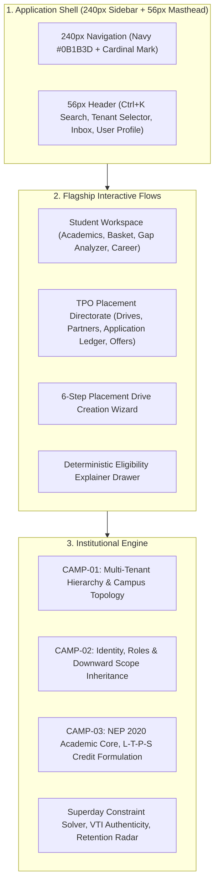

# Meridian: The Lifelong Academic & Career Platform

[](https://github.com/shivendra911/meridian)
[](https://github.com/shivendra911/meridian)
[](https://github.com/shivendra911/meridian)
[](https://github.com/shivendra911/meridian)
[](https://github.com/shivendra911/meridian)
[](https://github.com/shivendra911/meridian)

> **Meridian** is a lifelong academic and career platform designed to guide an individual across their educational and professional trajectory — from university enrollment through executive career development.

---

## Design System

The Meridian interface follows a unified, deterministic design system built on **Tailwind CSS v4** and **Inter Variable**:

- **90% Neutral Canvas**: Canvas (`#F6F7F9`), Cards/Surfaces (`#FFFFFF`), Borders (`#E5E7EB` 1px solid), Text (`#111827`), Secondary Text (`#6B7280`).
- **Focused Palette**: Navy (`#0B1B3D`) serves as the primary brand color for sidebars, primary buttons, and active tabs. Cardinal (`#8C1515`) is reserved exclusively for the logo mark.
- **One Font & Consistent Hierarchy**: Inter Variable with `tabular-nums` for all metrics, CGPAs, CTC packages, and dates.
- **Spacing Grid & Flat Surfaces**: Strict 4px spacing scale, standard 8px radius (`rounded-lg`), 16px internal card padding, 24px section gaps, 32px page margins, with flat borders and no card drop-shadows.
- **Accessible Primitives**: `PageHeader`, `StatCard`, `Button`, `Card`, `Badge`, `Tabs`, `SlideOverDrawer`, `Modal`, `Skeleton`, and `EmptyState`.

---

## Flagship Workflows

### 1. TPO Placement Drive Wizard & Eligibility Explainer Drawer
- **6-Step Guided Creation Wizard** (`PlacementDriveWizard.tsx`):
  1. Company & Opportunity (Partner selection, tier classification, CTC, location)
  2. Eligibility & Criteria Filtering (CGPA cutoff, active backlogs, batch year, branches)
  3. Selection Workflow (Online assessments, technical interview rounds, fitment)
  4. Superday Scheduling & Conflict Solver (Lab terminal reservations, clash detection)
  5. Quotas & Policy (Intake targets, offer acceptance deadlines, diversity)
  6. Review, Simulation & Publish
- **Real-Time Candidate Estimator**: Calculates eligible candidate counts in real time as sliders and filters change.
- **Deterministic Eligibility Explainer** (`EligibilityExplainerDrawer.tsx`): Inspects rule-by-rule matching against authoritative records (degree, CGPA, backlogs, cohort, DPDP consent) with one-click committee waiver requests.

### 2. Student Academic & Career Hub
- **Metric Highlights**: 4 KPI cards for CGPA, Completed Credits, Active Placement Drives, and Attendance.
- **2/3 + 1/3 Grid Architecture**:
  - **Main Panel**:
    - Current enrolled courses with verified attendance and CIE scores.
    - Course registration basket with real-time prerequisite gating and atomic seat reservations.
    - Prerequisite & concept gap analyzer recommending review topics before advanced electives.
    - Eligible placement drives with application status tracking.
  - **Side Panel**:
    - Urgent action alerts (basket closure deadlines, scheduled interview slots).
    - NEP 2020 Multi-Exit Degree Milestones (Certificate, Diploma, Degree, Honours).
    - Faculty advisor contacts.

---

## Platform Architecture



---

## Technology Stack

| Layer | Technologies |
| :--- | :--- |
| **Backend Framework** | Django 5.x, Django REST Framework, Python 3.10+ |
| **Database Engine** | MongoDB 7.0+ Replica Set `rs0` (Multi-document ACID transactions) |
| **Frontend Framework** | React 19, TypeScript, Vite, Tailwind CSS v4 |
| **Typography & Design** | Inter Variable (`@fontsource-variable/inter`), Lucide React |
| **AI Subsystem** | Multi-Agent AI Gateway, DPDP Act 2023 PII Masking Engine |
| **Testing** | Pytest, Django Test Runner (114 passing tests) |

---

## Quickstart Guide

### Prerequisites
- Python 3.10+
- Node.js 18+ and npm
- MongoDB 7.0+ running as a replica set (`rs0`) on `localhost:27017`

### 1. Backend Setup
```bash
cd placeflow
python -m venv .venv
# On Windows:
.venv\Scripts\activate
# On macOS / Linux:
source .venv/bin/activate

pip install -r requirements.txt
python manage.py runserver 127.0.0.1:8000
```

### 2. Frontend Setup
```bash
cd placeflow/frontend
npm install
npm run dev
# Live at http://127.0.0.1:5173/
```

### 3. Run Test Suite
```bash
cd placeflow
.venv/Scripts/python -m pytest tests/ -v
# 114 passed in ~25s
```

---

## Verification & Status

- **Backend Test Suite**: **114 / 114 tests passing** with 0 regressions.
- **Frontend Production Build**: **`tsc -b && vite build` completes in <700ms** with 0 errors.
- **Live Local Services**:
  - Vite Frontend: `http://127.0.0.1:5173/`
  - Django API: `http://127.0.0.1:8000/api/overview/`
  - MongoDB 7.0+ Replica Set: `mongodb://localhost:27017/college_placement_db?replicaSet=rs0`

---

## License

MIT License &bull; Meridian Educational Foundation
