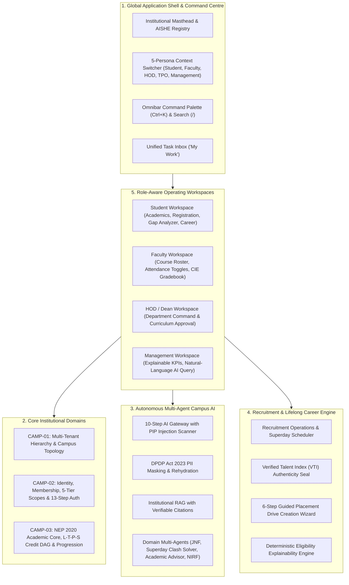

# Meridian: The Lifelong Academic & Career Operating System

[](https://github.com/shivendra911/meridian)
[](https://github.com/shivendra911/meridian)
[](https://github.com/shivendra911/meridian)
[](https://github.com/shivendra911/meridian)
[](https://github.com/shivendra911/meridian)
[](https://github.com/shivendra911/meridian)

> **Meridian** is a sovereign, enterprise-grade operating system designed to accompany an individual across their entire educational and professional trajectory — **from college matriculation to executive career retirement**.

---

## Architecture Overview



---

## 5 Operating Personas & Workspaces

Meridian replaces fragmented ERP portals with **one unified application shell** that dynamically morphs into the user's active operating responsibility:

1. **Student Workspace** (`StudentWorkspace.tsx`):
   - Academic Progress Ribbon (GPA, credits earned vs. graduation requirements).
   - Course registration basket with real-time prerequisite gating and atomic seat reservations.
   - Prerequisite concept-gap analyzer with study recommendations.
   - Verified career dossier and live Superday interview schedule.

2. **Faculty & Academic Advisor Workspace** (`FacultyWorkspace.tsx`):
   - Active course offering workbench with $L-T-P-S$ credit formulation.
   - One-click daily attendance matrix (`PRESENT` / `ABSENT` / `LATE`).
   - Continuous Internal Evaluation (CIE) gradebook on autonomous UGC 10-point scale with Dean moderation lock.
   - At-risk student watchlist and academic mentoring notes.

3. **HOD / Dean Workspace** (`HodWorkspace.tsx`):
   - Departmental teaching workload balance and seat capacity utilization.
   - Curriculum version draft approval queue with side-by-side diff inspection.
   - Student progression standing distribution (Promoted, Probationary, Retained).

4. **TPO Placement Workspace** (`RecruitmentPage.tsx`, `PlacementDriveWizard.tsx`):
   - 6-step guided drive creation wizard with **real-time qualifying student pool estimator**.
   - **Deterministic Eligibility Explainer Drawer**: Explains exact matched vs. failed conditions for every applicant.
   - **Superday Conflict Solver**: Interleaves interview schedules to avoid clashes with Day 1 partner slots.

5. **Executive Management Command** (`ManagementWorkspace.tsx`):
   - Multi-campus consolidated KPI ribbon (student population, program accreditation, NIRF readiness).
   - **Explainable Metrics Drawer**: Inspects cohort definition, exact formula, data sources, and refresh timestamps for any figure.
   - Natural-language executive AI query bar with verifiable citations.

---

## Guided Workflow Builders

- **Institutional Onboarding Builder** (`InstitutionalOnboardingBuilder.tsx`): 7-step guided setup with live DAG acyclic hierarchy tree checks.
- **Visual Curriculum Designer** (`CurriculumDesigner.tsx`): 3-panel syllabus architect with prerequisite DAG cycle detection and student transition simulation.
- **Role Assignment Wizard** (`RoleAssignmentWizard.tsx`): Enforces downward scope ceilings with **"What will this person be able to access?"** effective permission preview.
- **Advanced Data Grid** (`AdvancedDataGrid.tsx`): Filter chips, saved preset views, density toggle (compact/spacious), bulk selection, and CSV export.

---

## Technology Stack

| Layer | Technologies |
| :--- | :--- |
| **Backend Framework** | Django 5.x, Django REST Framework, Python 3.10+ |
| **Database Engine** | MongoDB 7.0+ Replica Set `rs0` (Multi-tenant document store with ACID multi-document transactions) |
| **Frontend Framework** | React 19, TypeScript, Vite, Tailwind CSS v4 |
| **Icons & Design Kit** | Lucide React, Custom Academic Design Tokens (`#8C1515` Cardinal, `#0B1B3D` Navy) |
| **AI Subsystem** | Google Gemini 2.5 Flash / Pro, Institutional Vector Store, DPDP Act 2023 PII Masking Engine |
| **Testing** | Pytest, Django Test Runner (114 passing enterprise test suite) |

---

## Quickstart Guide

### Prerequisites
- Python 3.10+
- Node.js 18+ and npm
- MongoDB 7.0+ running as a replica set (`rs0`) on `localhost:27017`

### 1. Backend Setup (Django API)
```bash
cd placeflow
python -m venv .venv
source .venv/bin/activate  # On Windows: .venv\Scripts\activate
pip install -r requirements.txt
python manage.py runserver 127.0.0.1:8000
```

### 2. Frontend Setup (React / Vite)
```bash
cd placeflow/frontend
npm install
npm run dev
# The client will be live on http://127.0.0.1:5173/
```

### 3. Run Test Suite
```bash
cd placeflow
.venv/Scripts/python -m pytest tests/ -v
# 114 passed in ~23s
```

---

## Verification & Telemetry

- **Backend Test Suite**: **114 / 114 tests passing** with 0 regressions.
- **Frontend Production Build**: **`tsc -b && vite build` completes in ~550ms** with zero errors or warnings.
- **Live Local Ports**:
  - Vite Frontend: `http://127.0.0.1:5173/`
  - Django API: `http://127.0.0.1:8000/api/overview/`
  - MongoDB 7.0+ Replica Set: `mongodb://localhost:27017/college_placement_db?replicaSet=rs0`

---

## License

Proprietary & Confidential &bull; Designed for Sovereign Institutional Deployment.
