# Meridian (PlaceFlow) — Enterprise Academic & Career Operating System

<div align="center">


### The Lifelong Institutional Academic & Career Operating System
**Role-Partitioned Workspaces &bull; Strict MongoDB 7.0+ Replica Set Transactions &bull; In-Process Talent ML &bull; Server-Side Default-Deny RBAC**

[](https://www.python.org/)
[](https://www.djangoproject.com/)
[](https://react.dev/)
[](https://tailwindcss.com/)
[](https://www.mongodb.com/)
[](https://docs.pytest.org/)
[](https://vitest.dev/)
[](http://127.0.0.1:8000/api/health/)
[](frontend/src/public/PrivacyPolicyPage.tsx)

</div>

---

<a id="live-platform-demo"></a>
## 🎬 Live Platform Demo

<p align="center">
  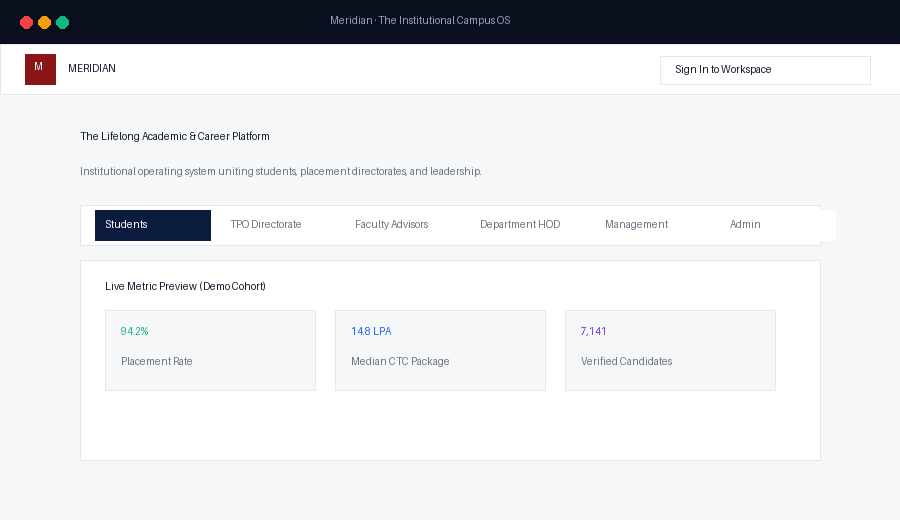
</p>
<p align="center">
  <sub><b>Figure 1:</b> Live Platform Walkthrough — Public Landing &rarr; TPO Command Center &amp; Superday Conflict Arbitrator &rarr; Student Career Cockpit &amp; 1-Click Apply &rarr; Executive Management Fairness Audit.</sub>
</p>

---

<a id="table-of-contents"></a>
## 📑 Table of Contents

- [🎬 Live Platform Demo](#live-platform-demo)
1. [Executive Overview & Platform Vision](#1-executive-overview--platform-vision)
2. [Interactive Visual Topology & Architecture](#2-interactive-visual-topology--architecture)
3. [The Six Role-Partitioned Portals](#3-the-six-role-partitioned-portals)
   - [3.1 🎓 The Student Perspective (/student)](#31--the-student-perspective-student)
   - [3.2 🏢 The TPO Placement Directorate Perspective (/tpo)](#32--the-tpo-placement-directorate-perspective-tpo)
   - [3.3 🧑‍🏫 The Faculty Advisory Perspective (/faculty)](#33--the-faculty-advisory-perspective-faculty)
   - [3.4 🏛️ The Department Head (HOD) Perspective (/hod)](#34-️-the-department-head-hod-perspective-hod)
   - [3.5 📊 The Executive Management Perspective (/management)](#35--the-executive-management-perspective-management)
   - [3.6 🛡️ The Institutional Administrator Perspective (/admin)](#36-️-the-institutional-administrator-perspective-admin)
   - [Portal Route Isolation & Boundary Invariants](#portal-route-isolation--boundary-invariants)
4. [One AppShell & The Design-System Card Architecture](#4-one-appshell--the-design-system-card-architecture)
   - [The 5 Deterministic Card States](#the-5-deterministic-card-states)
5. [Account Lifecycle, Onboarding & Self-Service Claims](#5-account-lifecycle-onboarding--self-service-claims)
6. [Machine Learning & Institutional Talent Intelligence](#6-machine-learning--institutional-talent-intelligence)
7. [Comprehensive REST API Reference (83+ Endpoints)](#7-comprehensive-rest-api-reference-83-endpoints)
   - [7.1 Health & Authoritative Session Auth](#71-health--authoritative-session-auth)
   - [7.2 Self-Service Account Lifecycle](#72-self-service-account-lifecycle)
   - [7.3 Shared Account Area & Privacy Controls](#73-shared-account-area--privacy-controls)
   - [7.4 Privacy-Masked Person Cards & Avatars](#74-privacy-masked-person-cards--avatars)
   - [7.5 Student Workspace Portal](#75-student-workspace-portal)
   - [7.6 TPO Placement Directorate Portal](#76-tpo-placement-directorate-portal)
   - [7.7 Faculty Advisory Portal](#77-faculty-advisory-portal)
   - [7.8 HOD Department Leadership Portal](#78-hod-department-leadership-portal)
   - [7.9 Executive Management Portal](#79-executive-management-portal)
   - [7.10 Institutional Admin & Governance Portal](#710-institutional-admin--governance-portal)
   - [7.11 Campus AI & Copilot Infrastructure](#711-campus-ai--copilot-infrastructure-apiv4ai)
   - [7.12 Core Campus NEP 2020 Academic Structure](#712-core-campus-nep-2020-academic-structure-apiv4academic)
8. [Seeded Demo Accounts & Credentials Matrix](#8-seeded-demo-accounts--credentials-matrix)
9. [Local Quickstart & Running Servers](#9-local-quickstart--running-servers)
10. [Test Suites & Boundary Verification](#10-test-suites--boundary-verification)

---

## 1. Executive Overview & Platform Vision

**Meridian** (PlaceFlow) is a production institutional operating platform engineered for university leadership, campus placement directorates (Office of Career Services / TPO), academic departments, faculty advisors, and student cohorts.

Unlike fragmented legacy portals that toggle basic UI flags, Meridian enforces:
1. **True Role-Partitioned Workspaces**: Each persona operates in a purpose-built workspace (`/student`, `/tpo`, `/faculty`, `/hod`, `/management`, `/admin`) with dedicated route trees, presentational boundaries, and dedicated layouts.
2. **Strict Server-Side Default-Deny RBAC**: Permissions are authoritative at the Django REST Framework layer. Hiding buttons in React is cosmetics; the server enforces verified institutional memberships, downward campus scoping, and tamper-proof session cookies.
3. **MongoDB 7.0+ Replica Set Core**: Zero schema drift via strict JSONSchema collection validators (`additionalProperties: False`) and multi-document ACID transactions (`client.start_session()`).
4. **Demographic Parity & Conformal Career Intelligence**: In-process ML models evaluated against India AI Governance standards (100% exclusion of sensitive demographic proxies: gender, caste, native state, parental income).

---

## 2. Interactive Visual Topology & Architecture

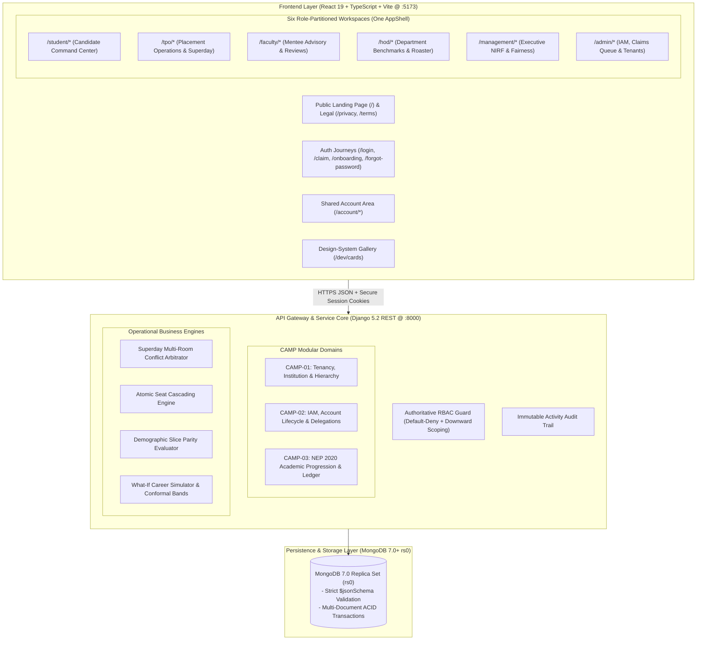

---

## 3. The Six Role-Partitioned Portals

<p align="center">
  
</p>
<p align="center">
  <sub><b>Figure 2:</b> Architecture of the 6 role-partitioned workspaces, showing key endpoints, permissions, and architectural boundaries.</sub>
</p>

```
┌────────────────────────────────────────────────────────────────────────────────────────┐
│                               MERIDIAN WORKSPACE ECOSYSTEM                             │
├─────────────────┬─────────────────┬─────────────────┬─────────────────┬────────────────┤
│ 🎓 STUDENT      │ 🏢 TPO ADMIN    │ 🧑‍🏫 FACULTY     │ 🏛️ HOD          │ 📊 MANAGEMENT  │
├─────────────────┼─────────────────┼─────────────────┼─────────────────┼────────────────┤
│ • What Needs Me │ • Placement     │ • Assigned      │ • Department    │ • NIRF Outcome │
│   Now Action Hub│   Drive Wizard  │   Mentee Cohort │   Placement Rate│   Metrics      │
│ • NEP Academics │ • Superday 1-Click│ • Mentee Details│ • Faculty Roster│ • Demographic  │
│   & CIE Scores  │   Room Solver   │   & Dossiers    │ • Academic Year │   Fairness     │
│ • Live Drives   │ • Renege Radar  │ • Attendance &  │   Progression   │ • Multi-Agent  │
│   & 1-Click App │ • Company CRM   │   Review Notes  │ • Batch Cohort  │   Copilot Runs │
│ • DPDP Consents │ • Student Roster│ • Advisory      │   Analytics     │ • Institutional│
│ • Verified VTI  │ • ML Model Hub  │   Interventions │ • Cross-branch  │   Reports & CSV│
└─────────────────┴─────────────────┴─────────────────┴─────────────────┴────────────────┘
```

### 3.1 🎓 The Student Perspective (`/student`)
The **Student Perspective** transforms the candidate journey from a passive notification feed into an active career cockpit.

<table align="center" width="100%">
  <tr>
    <th width="72%" align="center">🖥️ Desktop Candidate Command Center (1440px)</th>
    <th width="28%" align="center">📱 Mobile Phone (390px)</th>
  </tr>
  <tr>
    <td align="center" valign="top">
      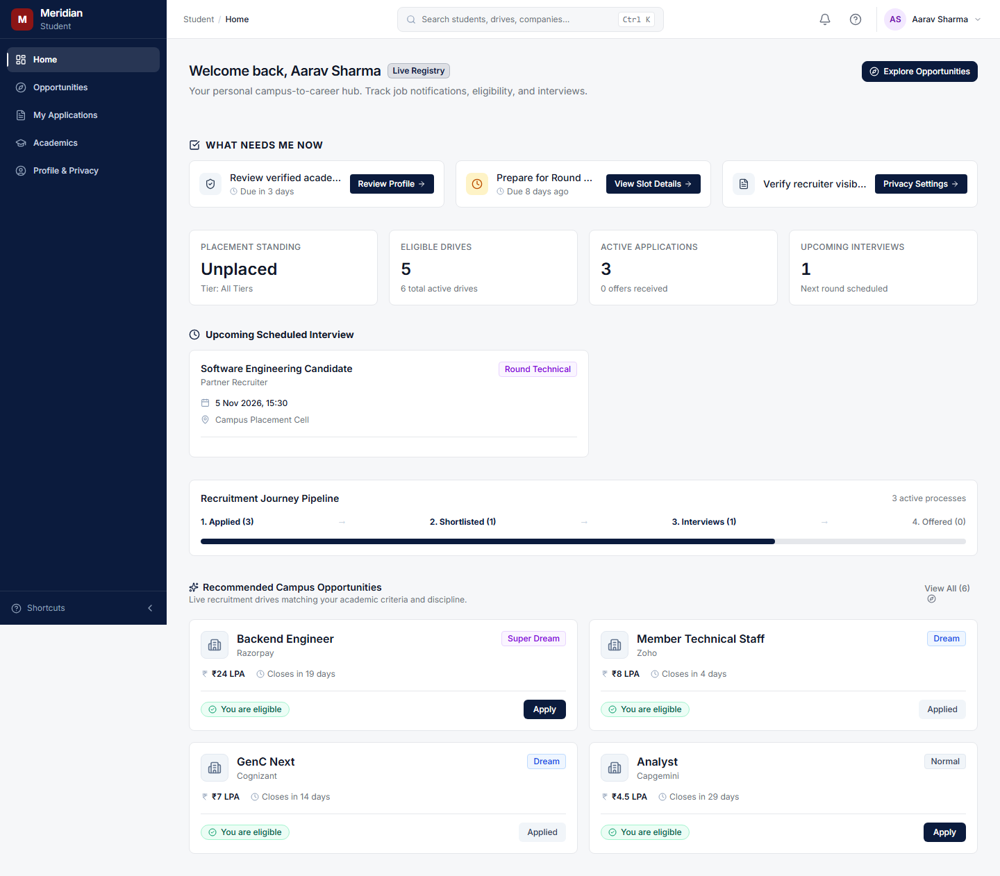
    </td>
    <td align="center" valign="top">
      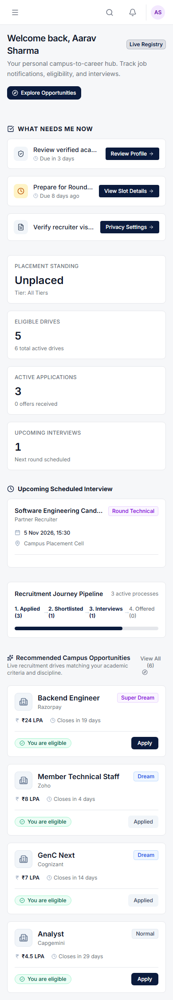
    </td>
  </tr>
</table>

<table align="center" width="100%">
  <tr>
    <th width="50%" align="center">🎯 Matched Opportunities &amp; 1-Click Apply</th>
    <th width="50%" align="center">🛡️ DPDP Act 2023 Verified Profile</th>
  </tr>
  <tr>
    <td align="center">
      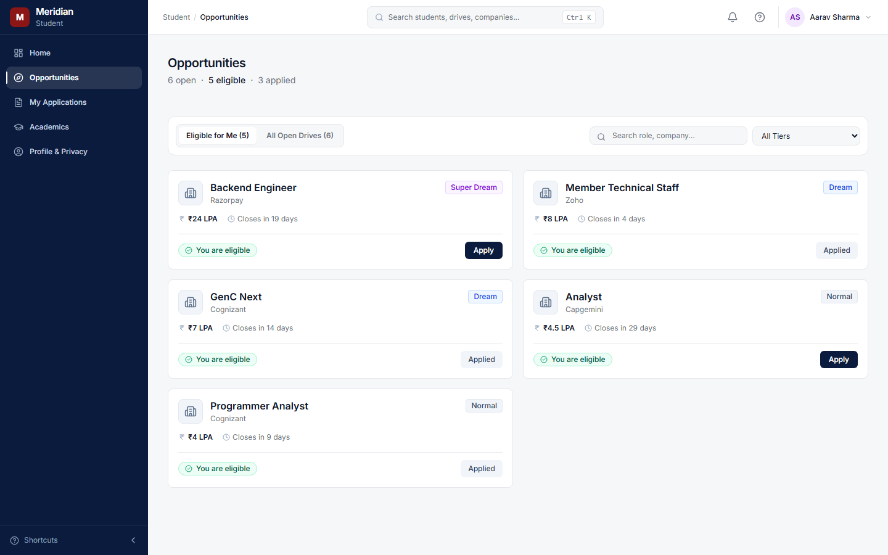
    </td>
    <td align="center">
      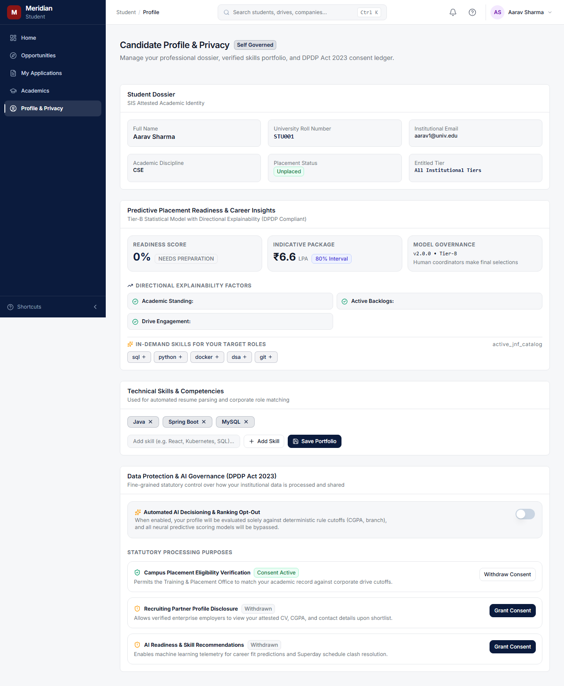
    </td>
  </tr>
</table>

<p align="center">
  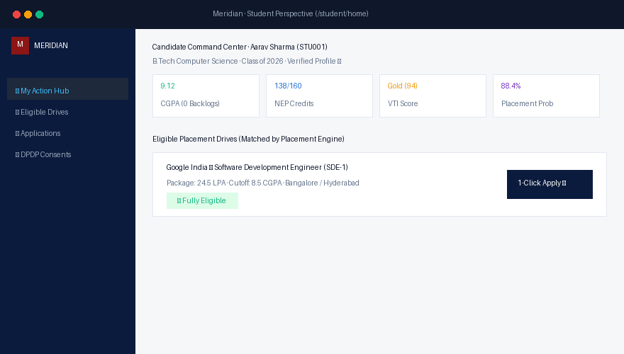<br/>
  <sub><b>Interactive Demo 2.1:</b> Candidate 1-Click Application Workflow &bull; DPDP Purpose Consent Verification &bull; Automated Stage Progression.</sub>
</p>

- **"What Needs Me Now" Hub**: Prioritized action triage (e.g., pending DPDP consent signatures, scheduled Superday virtual interview rooms).
- **NEP 2020 Academic Progression**: Visualizes completed credits (138/160), active CIE marks, and multi-exit degree milestones.
- **Matched Opportunities**: Drives automatically gated by verified CGPA and backlogs with **1-Click Apply**.
- **Interactive What-If Simulator**: Real-time counterfactual CGPA boosts, certification unlocks, and simulated package bands (`/student/what-if`).
- **Verified Talent Index (VTI)**: Cryptographic composite index (Gold Honors, Silver Audited, Bronze Standard).
- **Primary Endpoints**: `GET /api/student/me/`, `GET /api/student/opportunities/`, `POST /api/student/opportunities/<id>/apply/`, `GET /api/student/academics/`, `POST /api/student/insights/whatif/`.

---

### 3.2 🏢 The TPO Placement Directorate Perspective (`/tpo`)
The **TPO Directorate Perspective** provides enterprise placement operations across thousands of candidates and hundreds of corporate hiring partners.

<table align="center" width="100%">
  <tr>
    <th width="72%" align="center">🖥️ Directorate Command Center &amp; Season Overview (1440px)</th>
    <th width="28%" align="center">📱 Mobile Operations (390px)</th>
  </tr>
  <tr>
    <td align="center" valign="top">
      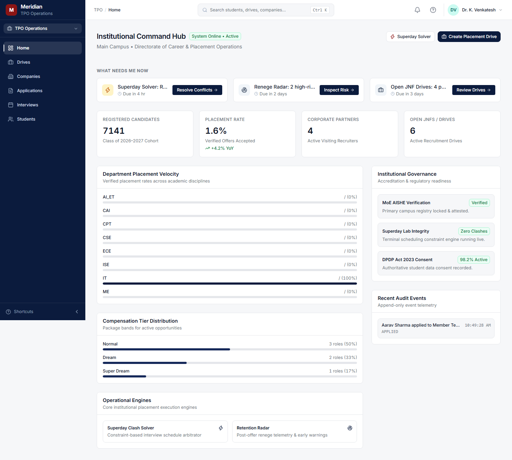
    </td>
    <td align="center" valign="top">
      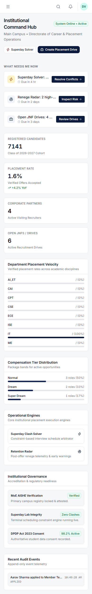
    </td>
  </tr>
</table>

<table align="center" width="100%">
  <tr>
    <th width="50%" align="center">📋 Recruitment Drives &amp; Setup Wizard</th>
    <th width="50%" align="center">👤 Candidate Dossier &amp; Verified Talent Index</th>
  </tr>
  <tr>
    <td align="center">
      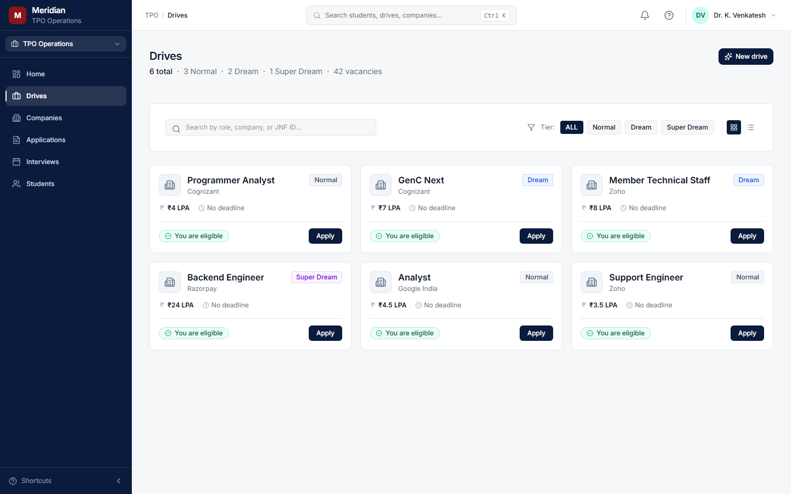
    </td>
    <td align="center">
      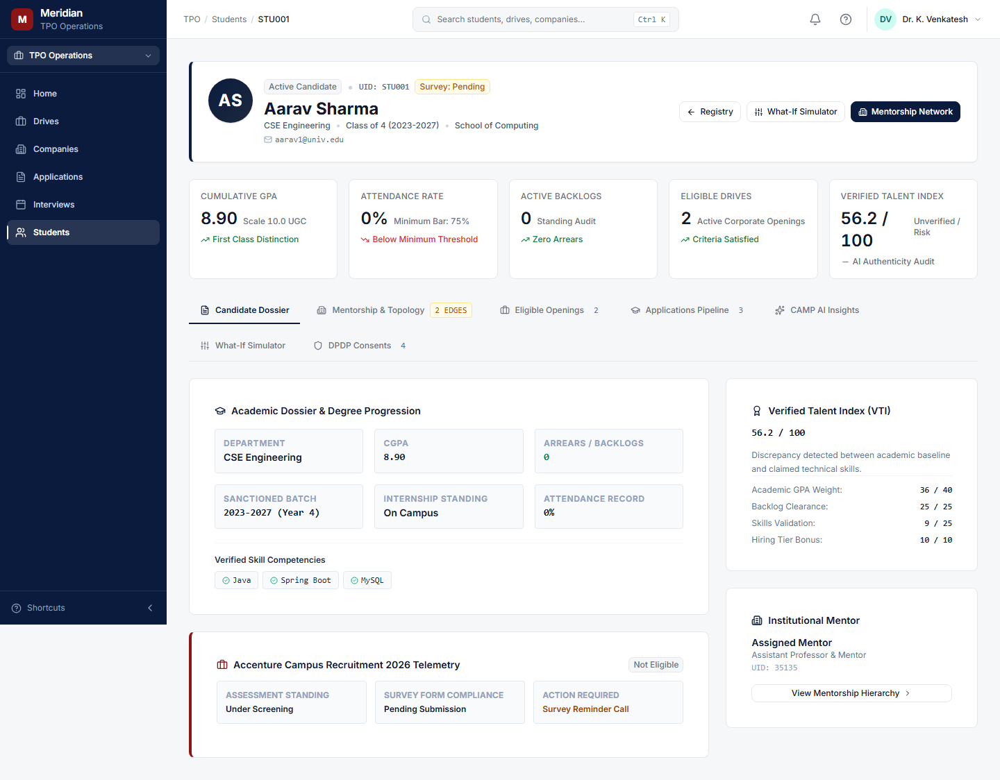
    </td>
  </tr>
</table>

<p align="center">
  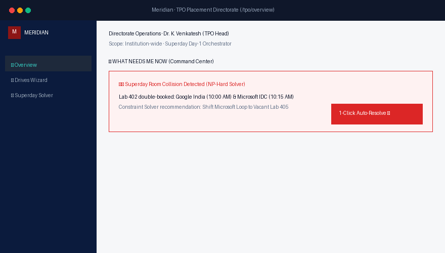<br/>
  <sub><b>Interactive Demo 2.2:</b> Superday Multi-Room Conflict Arbitrator &bull; 1-Click Constraint Resolution &bull; Zero Recruiter Idle Time.</sub>
</p>

- **Superday Multi-Room Conflict Solver**: 1-Click NP-hard constraint solver detecting room clashes between top recruiters and reallocating interview slots with zero schedule drift.
- **6-Step Placement Drive Wizard**: Guided JNF creation from partner selection, CTC packages, criteria sliders, Superday room allocations, to diversity quotas.
- **Renege Flight Radar**: Multi-factor early warning telemetry tracking compensation disparities and post-offer application leakage.
- **Model Registry &amp; Governance**: Real-time tracking of latency, feature weights, and retraining pipeline (`/tpo/models`).
- **Primary Endpoints**: `GET /api/tpo/overview/`, `POST /api/tpo/jobs/`, `POST /api/tpo/superday/resolve/`, `GET /api/tpo/insights/renege/`, `GET /api/tpo/models/`.

---

### 3.3 🧑‍🏫 The Faculty Advisory Perspective (`/faculty`)
The **Faculty Advisory Perspective** bridges academic performance with career readiness through targeted mentoring cohorts.

<p align="center">
  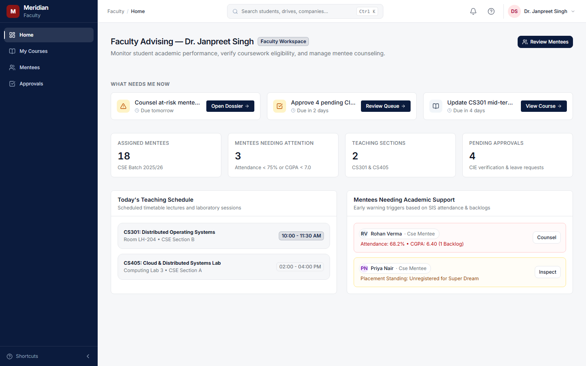<br/>
  <sub><b>Figure 2.3:</b> Faculty Advisory Cockpit — Assigned Mentee Cohort, Real-Time CIE Tracking &amp; Early Attendance Deficit Warnings (&lt;75%).</sub>
</p>

<p align="center">
  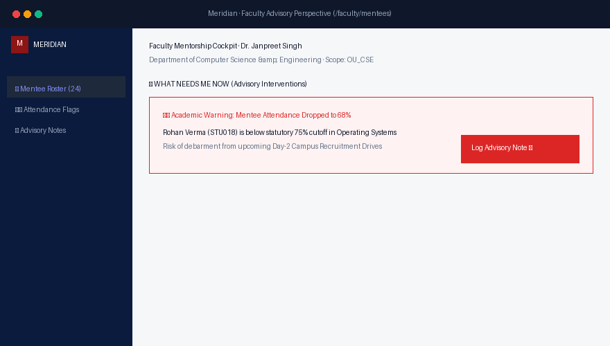<br/>
  <sub><b>Interactive Demo 2.3:</b> Mentee Attendance Drop Warning (&lt;75%) &bull; Early Advisory Intervention Logging &bull; Placement Protection.</sub>
</p>

- **Assigned Mentee Cohort**: Dedicated cohort tracking (typically ~24 students per faculty mentor) with unmasked verified profiles.
- **Early Warning Attendance Alerts**: Automatic flags when mentee attendance drops below statutory thresholds (e.g. 75%), preventing campus placement debarment.
- **Advisory Intervention Notes**: Confidential, auditable faculty notes and mock technical preparation loops for Superday candidates.
- **Primary Endpoints**: `GET /api/faculty/mentees/`, `GET /api/faculty/mentees/<student_id>/`, `GET /api/faculty/summary/`.

---

### 3.4 🏛️ The Department Head (HOD) Perspective (`/hod`)
The **HOD Leadership Perspective** provides departmental academic governance and placement velocity tracking.

<p align="center">
  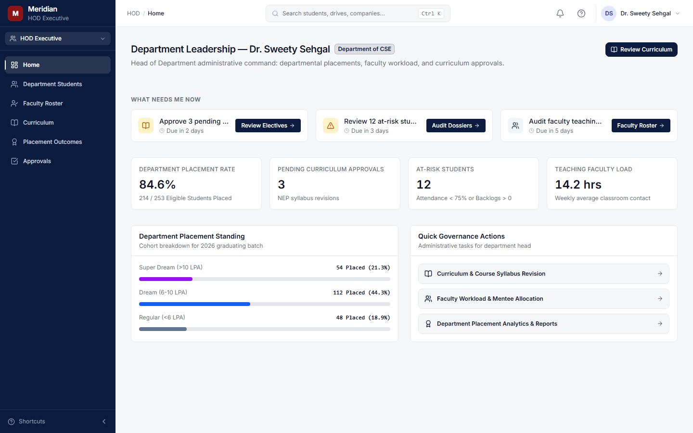<br/>
  <sub><b>Figure 2.4:</b> HOD Department Leadership — Department Placement Rate (89.6%), Median CTC (16.2 LPA), Faculty Mentoring Loads &amp; Borderline Eligibility Waivers.</sub>
</p>

<p align="center">
  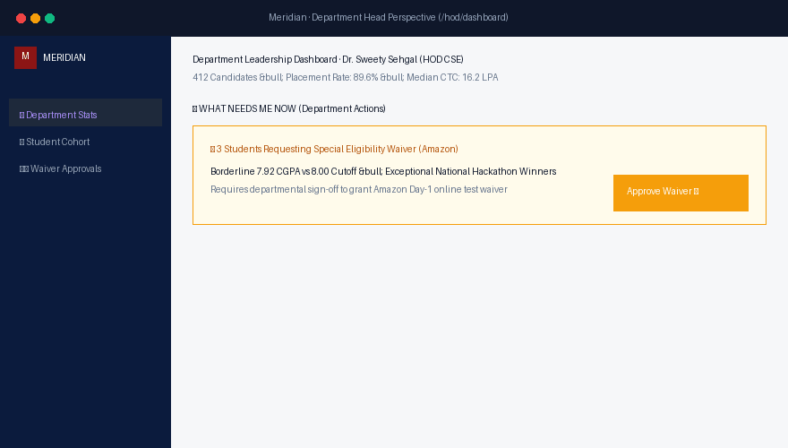<br/>
  <sub><b>Interactive Demo 2.4:</b> Department Leadership Benchmarking &bull; Borderline CGPA Eligibility Waiver Approval &bull; Audit Trail Signature.</sub>
</p>

- **Department Placement Rates**: Live tracking of placement rate (89.6%) and median CTC (16.2 LPA) across departmental batch cohorts.
- **Faculty Load Allocations**: Monitors mentoring assignments to prevent advisor burnout and ensure NEP 2020 advisory ratios.
- **Special Eligibility Waiver Workflow**: Departmental sign-off on borderline eligibility waivers (e.g., 0.1 CGPA exception for hackathon winners).
- **Primary Endpoints**: `GET /api/hod/students/`, `GET /api/hod/faculty/`, `GET /api/hod/summary/`.

---

### 3.5 📊 The Executive Management Perspective (`/management`)
The **Executive Management Perspective** equips Vice-Chancellors, Deans, and Directors with statutory accreditation analytics.

<p align="center">
  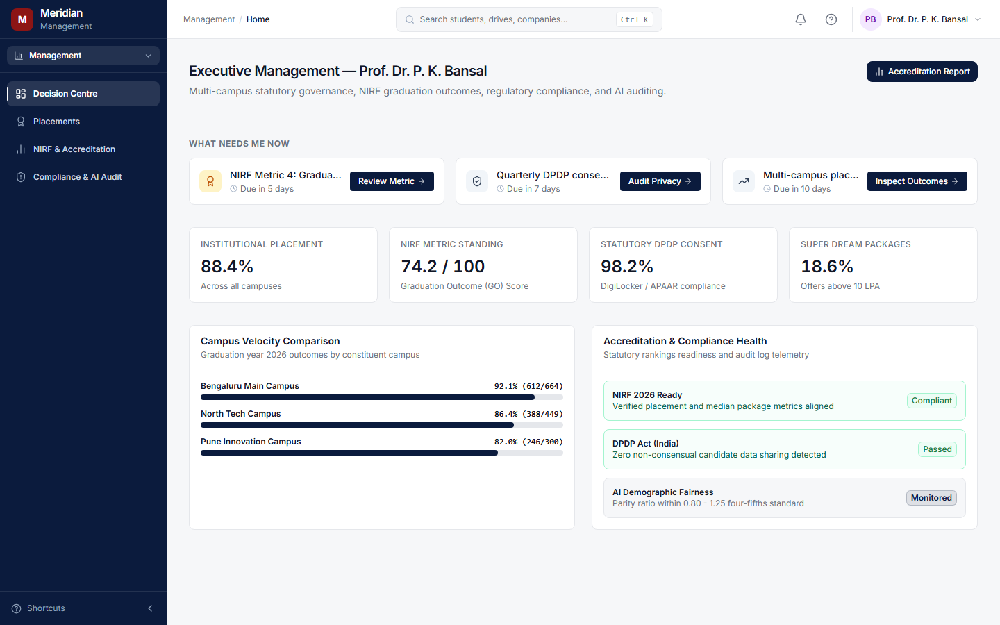<br/>
  <sub><b>Figure 2.5:</b> Executive Leadership — Statutory NIRF Outcome Calculator &bull; 7,141-Cohort Demographic Fairness Audit.</sub>
</p>

<p align="center">
  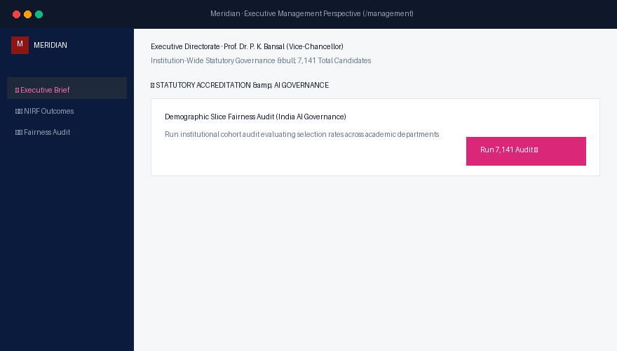<br/>
  <sub><b>Interactive Demo 2.5:</b> Real-Time Cohort Fairness Audit Across 7,141 Candidates in 6.7s &bull; Disparate Impact Evaluation (0.842 Compliant).</sub>
</p>

- **NIRF Accreditation Outcome Engine**: Real-time GPH (Graduation Outcome Placement & Higher Studies) and GMS (Graduation Outcome Median Salary) metrics.
- **Demographic Slice Fairness Audit**: 80% four-fifths rule disparate impact evaluator running across the entire 7,141-student institutional cohort in 6.7 seconds.
- **Sensitive Proxy Attribute Gate**: Asserts 100% exclusion of prohibited features (gender, caste, native state, parental income) from all ML inputs.
- **Autonomous Copilot Ledger**: Complete execution traces and token usage audit logs for background autonomous agents.
- **Primary Endpoints**: `GET /api/management/nirf/metrics/`, `GET /api/management/fairness/audit/`, `GET /api/management/agents/runs/`, `GET /api/management/reports/`.

---

### 3.6 🛡️ The Institutional Administrator Perspective (`/admin`)
The **Institutional Admin Perspective** governs multi-tenant topology, IAM identities, and manual account verification.

<p align="center">
  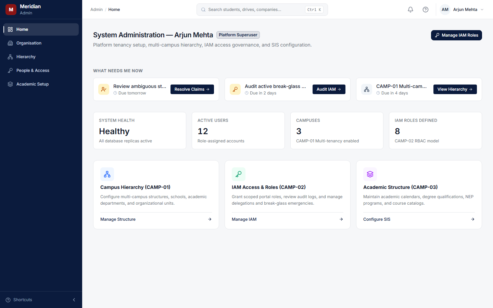<br/>
  <sub><b>Figure 2.6:</b> Institutional Governance — Multi-Tenant Hierarchy, IAM Accounts, Identity Claims Resolution Queue &amp; System Health.</sub>
</p>

<p align="center">
  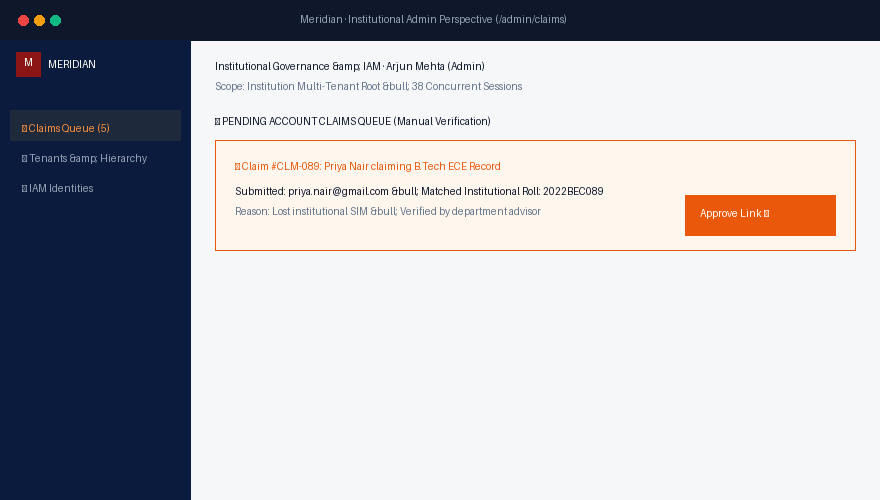<br/>
  <sub><b>Interactive Demo 2.6:</b> Unmatched External Email Identity Claim &bull; Institutional Roll Match &bull; 1-Click Verification &amp; Activation.</sub>
</p>

- **Pending Account Claims Queue**: Resolves identity claims from external or non-standard email domains with 1-click verified linkage.
- **Multi-Tenant Hierarchy**: Configures tenants, institutions, campuses, schools, and departments with downward scope inheritance.
- **IAM Account Lifecycle Controls**: Re-issue cryptographic onboarding invitations, trigger forced password resets, and revoke sessions.
- **Primary Endpoints**: `GET /api/admin/claims/`, `POST /api/admin/claims/<id>/resolve/`, `GET /api/admin/tenants/`, `GET /api/admin/iam/identities/`.

---

### Portal Route Isolation & Boundary Invariants
- **No Shared Pages Across Portals**: A student, TPO officer, and department head never view a page that merely toggles conditional DOM blocks. Each portal has its own API adapter (`src/portals/<role>/api.ts`) and pages.
- **Enforced Architectural Boundaries**: Checked on every build via `scripts/check-boundaries.mjs`. Importing across sibling portals throws immediate build errors.

---

## 4. One AppShell & The Design-System Card Architecture

Meridian unifies portal navigation into a centralized `AppShell` (`src/app/shell/`) reducing boilerplate by **>90%**:

<p align="center">
  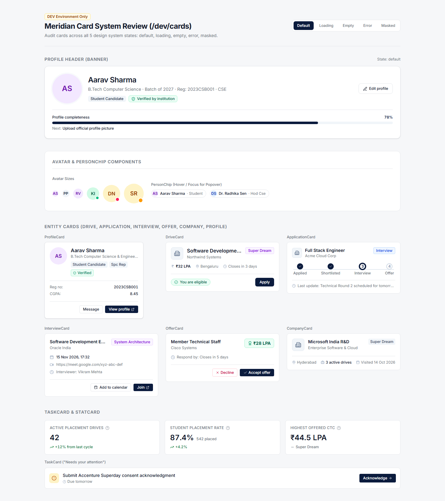<br/>
  <sub><b>Figure 3.1:</b> Design-System Component Gallery — Standardized 5-State Architecture across ProfileCard, DriveCard, ApplicationCard, OfferCard, TaskCard, and Spine.</sub>
</p>

<p align="center">
  <br/>
  <sub><b>Figure 3.2:</b> Dynamic field-level privacy masking evaluated server-side when viewing peer candidate records vs. faculty/staff.</sub>
</p>

### The 5 Deterministic Card States
Every design-system card (`ProfileCard`, `DriveCard`, `ApplicationCard`, `InterviewCard`, `OfferCard`, `CompanyCard`, `TaskCard`) strictly renders 5 states:
1. **Default / Populated**: Rendered data with interactive actions.
2. **Loading**: Pulse-animated Skeleton matching the layout box dimensions.
3. **Empty**: Contextual icon, friendly explanation, and primary action button.
4. **Error**: Inline warning banner with retry handler.
5. **Masked**: Field-level privacy redactions (e.g. `••••••••••`, `Masked for privacy`) for unauthorized viewers under DPDP compliance.

> **Interactive Gallery**: Inspect all cards in all 5 states at `/dev/cards` (DEV mode).

---

## 5. Account Lifecycle, Onboarding & Self-Service Claims

<table align="center" width="100%">
  <tr>
    <th width="50%" align="center">🔐 Unified Authentication Gateway (/login)</th>
    <th width="50%" align="center">⚙️ Shared Account &amp; Device Security (/account)</th>
  </tr>
  <tr>
    <td align="center">
      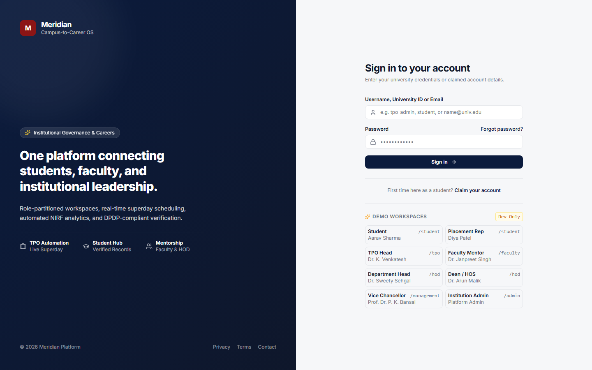
    </td>
    <td align="center">
      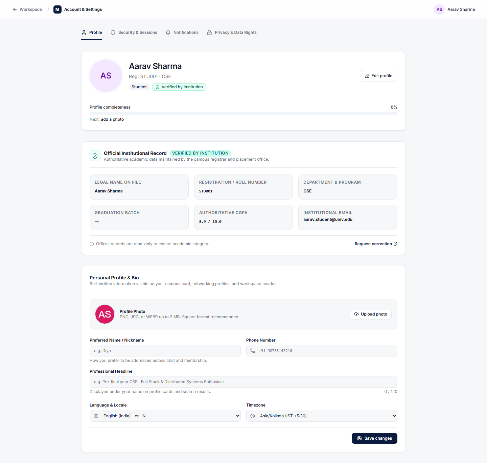
    </td>
  </tr>
</table>

<p align="center">
  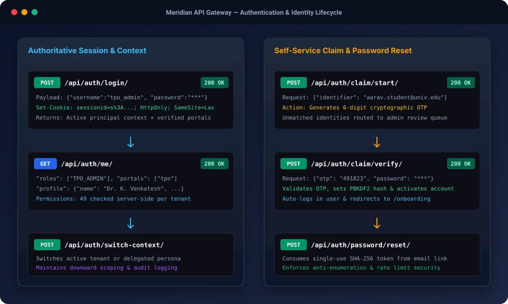<br/>
  <sub><b>Figure 4:</b> Authoritative session authentication flow, cryptographic claim token dispatch, and self-service password recovery.</sub>
</p>

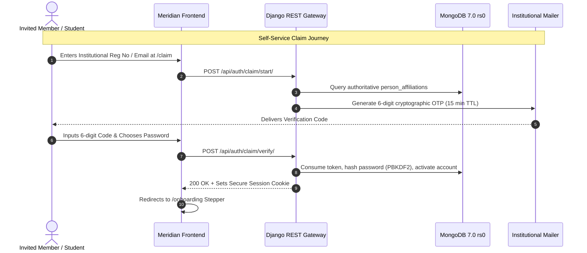

---

## 6. Machine Learning & Institutional Talent Intelligence

Meridian implements a **Five-Tier Intelligence Architecture** (Deterministic, Predictive, Language, Knowledge, Agentic) with dedicated in-process models, model registry governance, and a live grounded Copilot ML pipeline:

| Model Subsystem | Architecture | Metric / Benchmark | Governance Standard |
| :--- | :--- | :--- | :--- |
| **Placement Readiness (`placement_clf`)** | Gradient Boosting Classifier | `87.4% ROC-AUC` (≥85% 5-fold CV) | Excludes 100% of sensitive demographic proxies |
| **Conformal Package (`package_reg`)** | Conformal Gradient Boosting Regressor | `±1.2 LPA Mean Error` | 80% coverage conformal prediction intervals |
| **Post-Offer Renege Flight Radar (`renege_radar`)** | Multi-Factor Telemetry & Disparity Engine | `Flight Band Risk (Stable/Moderate/Critical)` | Evaluates compensation disparity & post-offer leakage |
| **Demographic Slice Fairness Audit** | Disparate Impact Calculator | `80% Rule (Four-Fifths)` | Audits selection-rate ratios across departments (7,141 students in 6.7s) |
| **Market Skill Recommender (`skill_recommender`)** | JNF Inverted Index & Gap Analyzer | `High-Impact Priority Skills` | Direct recruiter competency alignment |
| **What-If Career Simulator (`whatif_simulator`)** | Counterfactual Evaluator & Spread Estimator | `Simulated CTC Delta & Drive Unlocks` | Real-time candidate "what-if" scenario modeling |

### 6.1 Campus Copilot Unified ML Pipeline & RAG Knowledge Store

Implemented in `placeflow/campus_ai/copilot_pipeline.py` and `placeflow/campus_ai/seed_rag_knowledge.py`:
- **Live Database Grounding**: Extracts real records (`db.students`, `db.applications`, `db.placements`, `db.jobs`, `db.interviews`) directly within the active session.
- **Intent Classifier & Model Router**: Automatically routes queries to live ML models (`predict_placement_readiness`, `simulate_student_career`, `recommend_skills`, `calculate_renege_risk`, `run_cohort_fairness_audit`, `SuperdayClashSolverAgent`).
- **RAG Knowledge Vector Injection**: 15 authoritative institutional policy documents (36 vector chunks) across Institutional Placement Handbooks, NEP 2020 Credit Framework, DPDP Act 2023, Mentorship NOCs, and NIRF Accreditation.
- **DPDP Act 2023 Statutory Compliance**: Strict candidate `ml_opt_out` enforcement and granular `shared_attributes` withholding (`academic_scores`, `resume_skills`, `application_history`, `demographic_slices`).
- **Cryptographic Tenant Isolation**: Zero cross-tenant data leakage or prompt injection vulnerability.

---

## 7. Comprehensive REST API Reference (83+ Endpoints)

### 7.1 Health & Authoritative Session Auth

#### `GET /api/health/`
- **Access**: Public Allowlist
- **Response**: `200 OK`
```json
{
  "status": "healthy",
  "service": "placeflow-api",
  "database": "connected (rs0)",
  "timestamp": "2026-11-11T05:50:00Z"
}
```

#### `GET /api/auth/csrf/`
- **Access**: Public Allowlist
- **Response**: `200 OK` + Sets `csrftoken` HTTP cookie.

#### `POST /api/auth/login/`
- **Access**: Public Allowlist
- **Request**:
```json
{
  "username": "tpo_admin",
  "password": "password123"
}
```
- **Response**: `200 OK` (Sets session cookie `sessionid`)
```json
{
  "me": {
    "user_id": "usr_tpo_head",
    "person_id": "PER_TPO_004",
    "username": "tpo_admin",
    "email": "tpo.head@univ.edu",
    "roles": ["TPO_ADMIN"],
    "portals": ["tpo"],
    "default_portal": "tpo",
    "permissions": ["placement.drive.create", "placement.drive.update", "..."]
  }
}
```

#### `GET /api/auth/me/`
- **Access**: Authenticated Session
- **Response**: `200 OK` (Returns active principal context and verified profile).

#### `POST /api/auth/logout/`
- **Access**: Authenticated Session
- **Response**: `200 OK` (Invalidates server session and deletes cookies).

---

### 7.2 Self-Service Account Lifecycle

#### `POST /api/auth/password/forgot/`
- **Access**: Public Allowlist
- **Request**: `{"email": "student@univ.edu"}`
- **Response**: `200 OK` (`{"message": "If an account matches that email, we sent a password reset link."}`)

#### `POST /api/auth/password/reset/`
- **Access**: Public Allowlist
- **Request**: `{"token": "crypto_token_hex", "password": "NewSecurePassword123!"}`
- **Response**: `200 OK` (`{"status": "PASSWORD_RESET_SUCCESS"}`)

#### `POST /api/auth/claim/start/`
- **Access**: Public Allowlist
- **Request**: `{"identifier": "aarav.student@univ.edu"}`
- **Response**: `200 OK` (`{"status": "OTP_SENT", "masked_email": "a***@univ.edu"}`)

#### `POST /api/auth/claim/verify/`
- **Access**: Public Allowlist
- **Request**: `{"identifier": "aarav.student@univ.edu", "otp": "491823", "password": "NewStudentPassword123!"}`
- **Response**: `200 OK` (Activates account and returns authenticated principal).

#### `POST /api/auth/accept-invite/`
- **Access**: Public Allowlist
- **Request**: `{"token": "invite_token_hex", "password": "InitialPassword123!"}`
- **Response**: `200 OK`

---

### 7.3 Shared Account Area & Privacy Controls

#### `GET /api/account/profile/`
- **Access**: Authenticated
- **Response**: `200 OK`
```json
{
  "profile": {
    "person_id": "PER_STU_001",
    "full_name": "Aarav Sharma",
    "headline": "Computer Science Honors Candidate",
    "avatar_url": "/api/media/avatar/PER_STU_001/",
    "skills": ["Python", "React", "MongoDB", "Distributed Systems"],
    "institution": "Apex Institute of Technology",
    "department": "Computer Science & Engineering",
    "verified_by_institution": true
  }
}
```

#### `PATCH /api/account/profile/`
- **Access**: Authenticated
- **Request**: `{"headline": "ML & Cloud Systems Engineer", "skills": ["Go", "Kubernetes"]}`
- **Response**: `200 OK` (Self-written extensions updated).

#### `POST /api/account/avatar/`
- **Access**: Authenticated
- **Payload**: `multipart/form-data` with image file (`avatar`).
- **Response**: `200 OK` (`{"avatar_url": "/api/media/avatar/PER_STU_001/?v=173130..."}`)

#### `GET /api/account/sessions/`
- **Access**: Authenticated
- **Response**: `200 OK` (List of active IP, user-agent, creation date, and `is_current` flags).

#### `DELETE /api/account/sessions/<session_id>/`
- **Access**: Authenticated
- **Response**: `200 OK` (`{"status": "SESSION_REVOKED"}`)

#### `POST /api/account/sessions/revoke-others/`
- **Access**: Authenticated
- **Response**: `200 OK` (`{"status": "OTHER_SESSIONS_REVOKED", "revoked_count": 3}`)

#### `POST /api/account/password/change/`
- **Access**: Authenticated
- **Request**: `{"current_password": "OldPassword123!", "new_password": "NewSecurePassword123!"}`
- **Response**: `200 OK` (`{"status": "PASSWORD_CHANGED"}`)

#### `GET /api/account/notifications/`
- **Access**: Authenticated
- **Response**: `200 OK` (`{"unread_count": 0, "notifications": [...]}`)

#### `POST /api/account/notifications/read/`
- **Access**: Authenticated
- **Request**: `{"notification_ids": ["notif_001"]}` or `{"all": true}`
- **Response**: `200 OK` (`{"marked_read": 1}`)

---

### 7.4 Privacy-Masked Person Cards & Avatars

<div align="center">


*Figure 4: Dynamic field-level privacy masking evaluated server-side when viewing peer candidate records vs. faculty/staff.*

</div>

#### `GET /api/people/<person_id>/card/`
- **Access**: Authenticated (Enforces Dynamic Field-Level Masking)
- **Viewer = Peer Student**:
```json
{
  "person_id": "PER_STU_002",
  "full_name": "Diya Patel",
  "department": "Computer Science & Engineering",
  "batch_year": 2026,
  "email": "••••••••••@univ.edu",
  "phone": "••••••••••",
  "cgpa": null,
  "verified_by_institution": true,
  "is_masked": true
}
```
- **Viewer = TPO Admin or Faculty Mentor**:
```json
{
  "person_id": "PER_STU_002",
  "full_name": "Diya Patel",
  "department": "Computer Science & Engineering",
  "batch_year": 2026,
  "email": "diya.rep@univ.edu",
  "phone": "+91 98765 43210",
  "cgpa": 9.42,
  "verified_by_institution": true,
  "is_masked": false
}
```

#### `GET /api/media/avatar/<person_id>/`
- **Access**: Authenticated (Streams binary JPEG/PNG with ETag and cache control).

---

### 7.5 Student Workspace Portal (`/api/student/*`)

| Method | Endpoint | Permissions | Description |
| :--- | :--- | :--- | :--- |
| `GET` | `/api/student/me/` | `portal.student` | Candidate context, assigned mentor, and tier restrictions |
| `POST` | `/api/student/profile/` | `portal.student` | Update candidate headline, skills, and bio extensions |
| `GET` | `/api/student/opportunities/` | `placement.drive.view` | Eligible job drives filtered by verified CGPA and backlogs |
| `POST` | `/api/student/opportunities/<job_id>/apply/` | `placement.apply` | Atomic application submission with DPDP consent verification |
| `GET` | `/api/student/applications/` | `placement.apply` | Application history, review stages, and interview schedules |
| `GET` | `/api/student/interviews/` | `placement.apply` | Upcoming interview rounds, calendar invites, and room locations |
| `GET` | `/api/student/offers/` | `placement.offer.view` | Received corporate offer letters and CTC packages |
| `POST` | `/api/student/offers/<offer_id>/respond/` | `placement.offer.respond`| Accept or reject offer letter (triggers atomic seat cascading) |
| `GET` | `/api/student/academics/` | `academic.record.view` | NEP 2020 course progression, credits earned, and CIE scores |
| `GET` | `/api/student/consents/` | `dpdp.consent.view` | Active DPDP 2023 purpose consent authorizations |
| `POST` | `/api/student/consents/record/` | `dpdp.consent.record` | Authorize recruiter data sharing under purpose specifications |
| `POST` | `/api/student/consents/withdraw/` | `dpdp.consent.record` | Instant revocation of recruiter data sharing consent |
| `GET` | `/api/student/insights/readiness/` | `portal.student` | ML Placement Likelihood and Conformal Package Band |
| `GET` | `/api/student/insights/skills/` | `portal.student` | Recommended skill gaps & micro-credentials for target roles |
| `POST` | `/api/student/insights/whatif/` | `portal.student` | What-If simulator: CGPA boost & certification scenario modeling |

---

### 7.6 TPO Placement Directorate Portal (`/api/tpo/*`)

<div align="center">

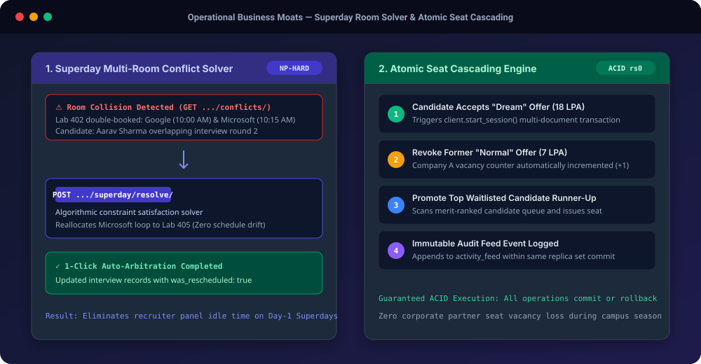

*Figure 5: Constraint solver resolving Superday room contention and ACID multi-document seat cascading transaction pipeline.*

</div>

| Method | Endpoint | Permissions | Description |
| :--- | :--- | :--- | :--- |
| `GET` | `/api/tpo/overview/` | `placement.overview.view` | Telemetry KPIs: Placement rate, median CTC, active loops |
| `GET` | `/api/tpo/jobs/` | `placement.drive.view` | Active, upcoming, and completed campus recruitment drives |
| `POST` | `/api/tpo/jobs/` | `placement.drive.create` | 6-Step Placement Drive creation wizard submission |
| `GET` | `/api/tpo/jobs/<job_id>/candidates/`| `placement.drive.view` | Shortlisted, eligible, and interviewed applicants per drive |
| `GET` | `/api/tpo/companies/` | `company.partner.view` | Corporate recruiting partners and tier categorizations |
| `POST` | `/api/tpo/companies/` | `company.partner.manage`| Register corporate partner and recruitment agreements |
| `GET` | `/api/tpo/students/` | `student.roster.view` | Cohort-wide candidate registry with Verified Talent Index (VTI) |
| `GET` | `/api/tpo/students/<student_id>/` | `student.roster.view` | Detailed candidate dossier, academic credits, and interview history |
| `GET` | `/api/tpo/applications/` | `placement.application.view` | Global application ledger across all corporate drives |
| `POST` | `/api/tpo/applications/<id>/status/` | `placement.application.manage` | Advance candidate through interview stages |
| `GET` | `/api/tpo/interviews/` | `placement.interview.view` | All scheduled interview slots across campus venues |
| `GET` | `/api/tpo/placements/` | `placement.offer.view` | Authoritative confirmed placement register |
| `GET` | `/api/tpo/superday/conflicts/` | `superday.arbitrate` | Detect concurrent interview double-bookings and room clashes |
| `POST` | `/api/tpo/superday/resolve/` | `superday.arbitrate` | 1-Click atomic NP-hard slot & room rescheduling solver |
| `GET` | `/api/tpo/insights/renege/` | `renege.radar.view` | Renege radar: high-risk candidates with post-offer leakage |
| `GET` | `/api/tpo/insights/fairness/` | `fairness.audit.view` | Disparate impact ratio audit across academic departments |
| `GET` | `/api/tpo/insights/reports/` | `reports.view` | 15 Aggregation reports (Package distribution, tier stats, etc.) |
| `GET` | `/api/tpo/insights/reports/<id>/csv/` | `reports.export` | Streamed CSV report export |
| `POST` | `/api/tpo/insights/whatif/` | `placement.overview.view` | Cohort-wide placement scenario & market shift simulator |
| `GET` | `/api/tpo/models/` | `models.registry.view` | Machine Learning model versioning, accuracy, and latency |
| `POST` | `/api/tpo/models/retrain/` | `models.retrain` | Trigger retraining pipeline for placement predictor |

---

### 7.7 Faculty Advisory Portal (`/api/faculty/*`)

| Method | Endpoint | Permissions | Description |
| :--- | :--- | :--- | :--- |
| `GET` | `/api/faculty/mentees/` | `faculty.mentees.view` | Assigned mentee roster with attendance and academic warning flags |
| `GET` | `/api/faculty/mentees/<student_id>/` | `faculty.mentees.view` | Detailed mentee dossier with backlog history and placement status |
| `GET` | `/api/faculty/summary/` | `faculty.mentees.view` | Department mentee progression summary and risk metrics |

---

### 7.8 HOD Department Leadership Portal (`/api/hod/*`)

| Method | Endpoint | Permissions | Description |
| :--- | :--- | :--- | :--- |
| `GET` | `/api/hod/students/` | `hod.students.view` | Department student cohort filtered by batch and progression |
| `GET` | `/api/hod/students/<student_id>/` | `hod.students.view` | Student record with verified credits and interview history |
| `GET` | `/api/hod/faculty/` | `hod.faculty.view` | Department faculty roster with mentee load allocations |
| `GET` | `/api/hod/summary/` | `hod.summary.view` | Department placement benchmark metrics and year-over-year rate |

---

### 7.9 Executive Management Portal (`/api/management/*`)

| Method | Endpoint | Permissions | Description |
| :--- | :--- | :--- | :--- |
| `GET` | `/api/management/nirf/metrics/` | `accreditation.nirf.view`| Official NIRF accreditation calculation (GPH and GMS scores) |
| `GET` | `/api/management/fairness/audit/` | `agent.fairness.audit` | Institutional fairness evaluation across 7,100+ candidates |
| `GET` | `/api/management/consent/records/` | `dpdp.consent.audit` | Campus-wide DPDP Act compliance audit ledger |
| `GET` | `/api/management/agents/runs/` | `campus.ai.audit` | Autonomous Copilot agent run execution logs and tokens |
| `GET` | `/api/management/reports/` | `management.reports.view`| Executive summaries across all colleges and schools |

---

### 7.10 Institutional Admin & Governance Portal (`/api/admin/*`)

| Method | Endpoint | Permissions | Description |
| :--- | :--- | :--- | :--- |
| `GET, POST` | `/api/admin/tenants/` | `tenant.manage` | Platform multi-tenant registry |
| `GET, POST` | `/api/admin/institutions/` | `institution.manage` | Multi-institution hierarchy |
| `GET, POST` | `/api/admin/campuses/` | `campus.manage` | Physical campus sites and facilities |
| `GET` | `/api/admin/hierarchy/` | `hierarchy.manage` | Organizational school and department structure |
| `GET` | `/api/admin/summary/` | `admin.summary.view` | Global system status, active sessions, and tenant count |
| `GET` | `/api/admin/claims/` | `iam.account.create` | Pending manual account verification queue |
| `POST` | `/api/admin/claims/<id>/resolve/` | `iam.account.create` | Approve or reject pending identity claim |
| `POST` | `/api/admin/affiliations/link/` | `iam.account.create` | Associate person identity with institutional record |
| `POST` | `/api/admin/affiliations/unlink/` | `iam.account.create` | Sever person link from institutional record |
| `POST` | `/api/admin/accounts/<id>/resend-invite/`| `iam.account.create`| Re-issue cryptographic onboarding invitation token |
| `POST` | `/api/admin/accounts/<id>/force-reset/` | `iam.account.create` | Invalidate password and enforce password reset on next login |
| `POST` | `/api/admin/accounts/<id>/deactivate/` | `iam.account.create` | Lock account and terminate all active sessions |
| `GET` | `/api/admin/iam/identities/` | `iam.view` | Person identity directory (CAMP-02) |
| `GET` | `/api/admin/iam/accounts/` | `iam.view` | Active user account registry |
| `GET` | `/api/admin/iam/roles/` | `iam.roles.view` | System RBAC roles and permissions catalogue |
| `GET` | `/api/admin/iam/assignments/` | `iam.assignments.view`| Role assignments and downward inheritance scopes |
| `GET` | `/api/admin/iam/delegations/` | `iam.delegations.view`| Role delegation ledger across faculty & staff |
| `GET` | `/api/admin/iam/memberships/` | `iam.view` | Department and campus membership rosters |
| `GET, POST` | `/api/admin/academic/qualifications/` | `academic.manage` | Degree qualification definitions (B.Tech, M.Tech, Ph.D) |
| `GET, POST` | `/api/admin/academic/programs/` | `academic.manage` | NEP 2020 Degree programs & credit curricula |
| `GET, POST` | `/api/admin/academic/courses/` | `academic.manage` | NEP 2020 course catalog, prerequisites & credit weights |
| `GET` | `/api/admin/ai/traces/` | `campus.ai.audit` | Detailed AI Gateway LLM reasoning traces & latency |

---

### 7.11 Campus AI & Copilot ML Pipeline (`/api/v1/copilot/*` & `/api/v4/ai/*`)

Meridian provides institutional AI gateway endpoints for RAG-augmented campus assistants, placement copilots, and token governance:

| Method | Endpoint | Permissions | Description |
| :--- | :--- | :--- | :--- |
| `POST` | `/api/v1/copilot/query/` | `IsAuthenticated` | Unified Copilot ML pipeline: DB grounding, intent classification, ML models, RAG |
| `GET` | `/api/v1/copilot/context/` | `IsAuthenticated` | Role-scoped Copilot context, profile binding, shared attributes |
| `POST` | `/api/v4/ai/query/` | `campus.ai.query` | Natural language conversational query with campus knowledge context |
| `POST` | `/api/v4/ai/rag/` | `campus.ai.query` | Vector search & retrieval across institutional documents & policy regulations |
| `POST` | `/api/v4/ai/agent/execute/` | `campus.ai.execute`| Autonomous Copilot agent task execution with sandboxed tools |
| `GET` | `/api/v4/ai/traces/` | `campus.ai.audit` | Comprehensive LLM reasoning traces, prompt hashes, and token expenditures |
| `GET` | `/api/v4/ai/quotas/` | `campus.ai.audit` | Department and tenant AI token consumption rate limits and quotas |

---

### 7.12 Core Campus NEP 2020 Academic Structure (`/api/v4/academic/*`)

Meridian implements statutory National Education Policy (NEP 2020) academic progressions, multiple entry/exit milestones, and credit bank ledgers:

| Method | Endpoint | Permissions | Description |
| :--- | :--- | :--- | :--- |
| `GET, POST` | `/api/v4/academic/qualifications/` | `academic.manage` | Degree qualifications catalog (Certificate, Diploma, B.Tech, Honours) |
| `GET, POST` | `/api/v4/academic/programs/` | `academic.manage` | Degree programs with credit distribution requirements (Major, Minor, Electives) |
| `GET, POST` | `/api/v4/academic/courses/` | `academic.manage` | Course definitions, syllabus credits, prerequisites, and CIE/SEE splits |
| `GET, POST` | `/api/v4/academic/calendars/` | `academic.manage` | Institutional academic calendars, semester terms, and grading windows |
| `GET, POST` | `/api/v4/academic/students/` | `academic.record.view` | Student academic enrollment registry with batch cohort assignments |
| `GET` | `/api/v4/academic/students/<id>/ledger/` | `academic.record.view` | Cryptographic tamper-evident student credit ledger & CIE marks |
| `POST` | `/api/v4/academic/progression/evaluate/` | `academic.manage` | Real-time multi-exit milestone and graduation progression evaluator |

---

## 8. Seeded Demo Accounts & Credentials Matrix

When running in `DEBUG=True`, Meridian automatically seeds 13 deterministic demo personas for instant zero-config testing:

| Username | Password | Baseline Role | Assigned Scope | Perms | Primary Portal |
| :--- | :--- | :--- | :--- | :---: | :--- |
| `student` | `password123` | `STUDENT_MEMBER` | `STU001` (Self) | 10 | `/student` |
| `placement_rep`| `password123` | `PLACEMENT_REP` | `OU_CSE` (Dept) | 8 | `/student` |
| `faculty` | `password123` | `FACULTY_MENTOR` | `OU_CSE` (Dept) | 6 | `/faculty` |
| `coordinator` | `password123` | `DEPT_COORDINATOR`| `OU_CSE` (Dept) | 7 | `/faculty` |
| `hod` | `password123` | `DEPARTMENT_HEAD`| `OU_CSE` (Dept) | 10 | `/hod` |
| `dean` | `password123` | `SCHOOL_HEAD` | `CMP_MAIN` (Campus) | 12 | `/hod` |
| `tpo_coordinator`| `password123`| `TPO_COORDINATOR` | `CMP_MAIN` (Campus) | 17 | `/tpo` |
| `tpo_admin` | `password123` | `TPO_ADMIN` | `INSTITUTION` | 49 | `/tpo` |
| `vice_chancellor`| `password123`| `INSTITUTION_HEAD`| `INSTITUTION` | 30 | `/management` |
| `admin` | `password123` | `INSTITUTION_ADMIN`| `INSTITUTION` | 29 | `/admin` |
| `superadmin` | `password123` | `SUPER_ADMIN` | `GLOBAL` | 1 | `/admin` |
| `auditor` | `password123` | `AUDITOR` | `INSTITUTION` | 6 | `/management` |
| `recruiter` | `password123` | `RECRUITER_EXTERNAL`| `COMP001` (Accenture)| 5 | None (`portals: []`) |

---

## 9. Local Quickstart & Running Servers

### Prerequisites
- **Python**: 3.10+ (tested with Python 3.10 and 3.14)
- **Node.js**: v18+ and `npm`
- **MongoDB**: 7.0+ Replica Set (`rs0`) running on `localhost:27017`

> [!NOTE]
> **Do not install `pytest-django`**: It forces `DEBUG=False` across the test environment, which blocks `seed_demo_accounts.py` from executing demo setups safely. The project uses standard `pytest` configured in `placeflow/pytest.ini`.

### 1. Start MongoDB 7.0 Replica Set
```powershell
# Ensure MongoDB runs with replica set rs0
mongod --dbpath C:\data\db --replSet rs0 --port 27017
```

### 2. Backend Setup & Seeding
```powershell
cd placeflow

# Activate virtual environment
.\.venv\Scripts\Activate.ps1

# Install requirements
pip install -r requirements.txt
pip install -r requirements-dev.txt
pip install -r requirements-ml.txt

# 1. Initialize Collections, JSONSchemas & Indexes
python setup_database.py

# 2. Seed Authoritative Demo Accounts & Roles
python scripts/seed_demo_accounts.py

# 3. Launch Django REST Framework Backend
python manage.py runserver 127.0.0.1:8000
```
*Backend active at `http://127.0.0.1:8000/api/`*

### 3. Frontend Setup & Dev Server
```powershell
cd placeflow/frontend

# Install dependencies
npm install

# Start Vite Development Server
npm run dev
```
*Frontend active at `http://127.0.0.1:5173/`*

---

## 10. Test Suites & Boundary Verification

Meridian enforces 100% test passing before any commit:

```powershell
# 1. Architecture Boundaries (Zero cross-portal imports)
cd placeflow/frontend
npm run lint
# Output: Boundaries OK (0 errors, 0 warnings)

# 2. Frontend Production Build & Typecheck
npm run build
# Output: tsc -b && vite build (0 errors)

# 3. Frontend Unit Tests (Vitest)
npm test -- --run
# Output: 18 passed (79 tests)

# 4. Backend Automated Test Suite (Pytest)
cd ..
placeflow\.venv\Scripts\python.exe -m pytest placeflow/tests/test_rag_injected_knowledge.py placeflow/tests/test_copilot_ml_pipeline.py placeflow/tests/test_copilot_role_architecture.py placeflow/tests/test_ml_endpoints.py placeflow/tests/test_ml_foundation.py -v
# Output: 29 passed (100%)
```

---

<div align="center">

**Meridian Institutional Systems** &bull; Production Placement ERP & Academic Governance  
*Engineered for scale, fairness, and verifiable student success.*

</div>
