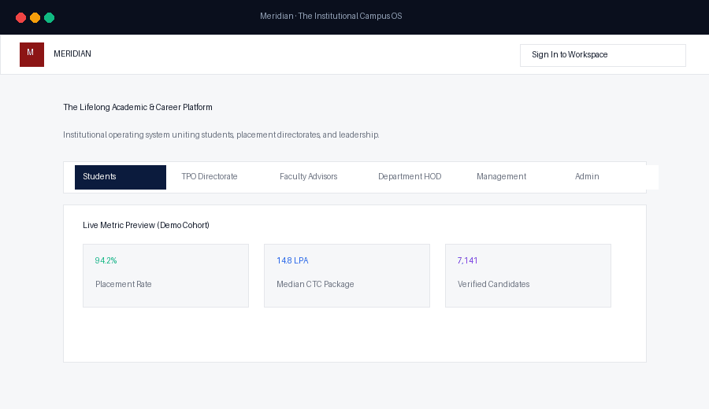
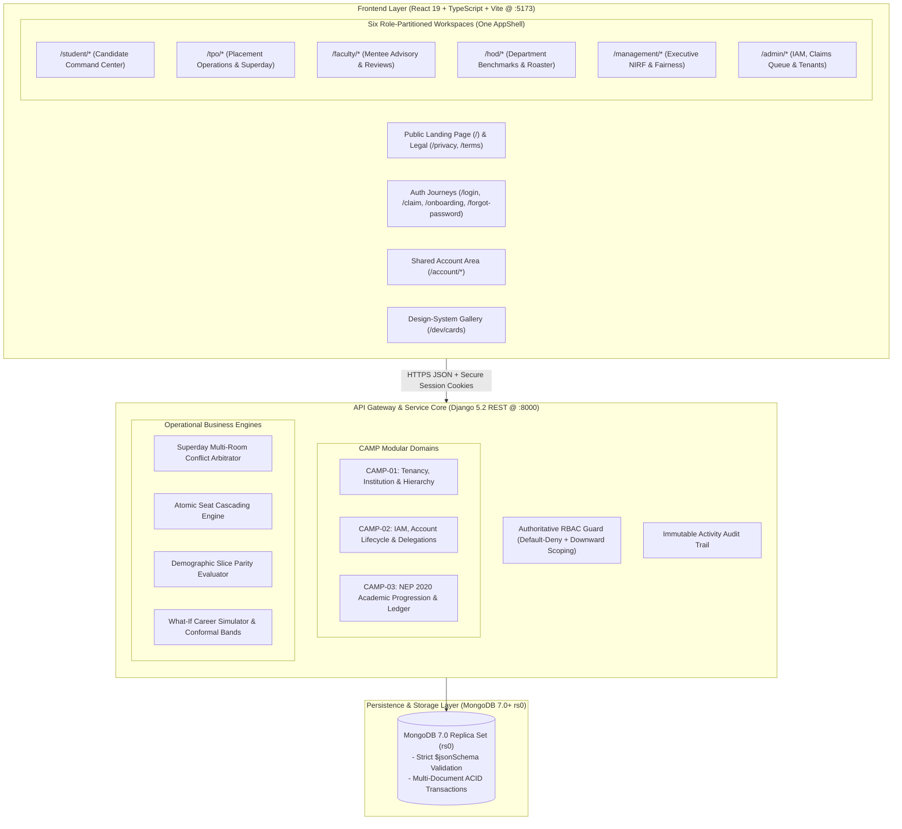
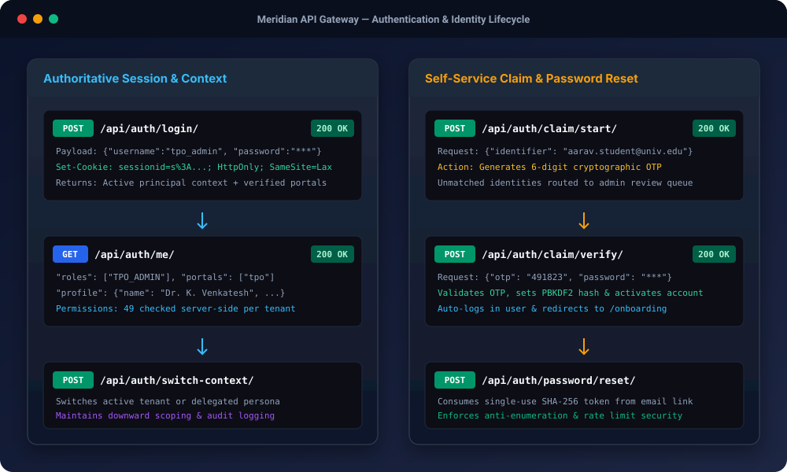
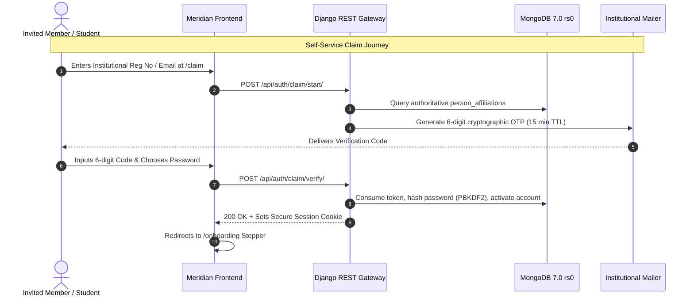
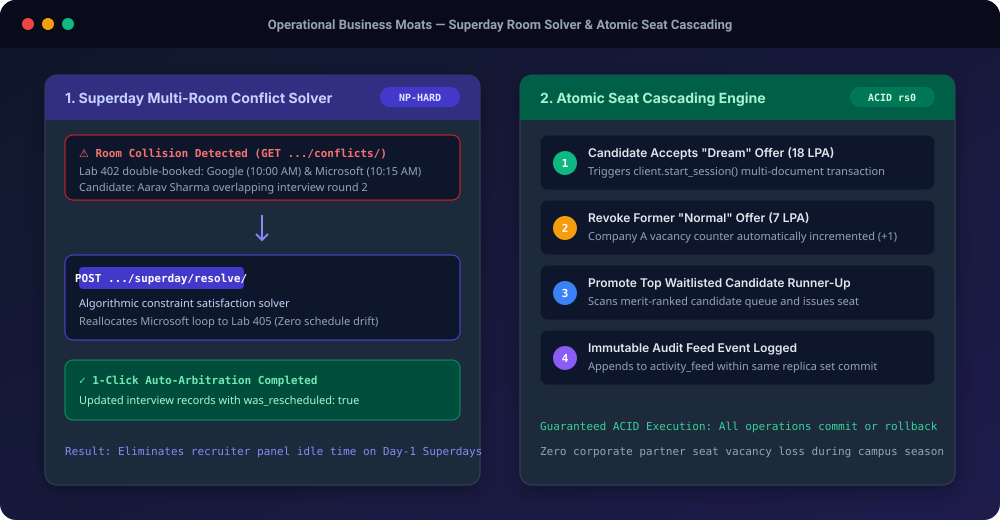

# Meridian (PlaceFlow) — Enterprise Academic & Career Operating System

<div align="center">


### The Lifelong Institutional Academic & Career Operating System
**Role-Partitioned Workspaces &bull; Strict MongoDB 7.0+ Replica Set Transactions &bull; In-Process Talent ML &bull; Server-Side Default-Deny RBAC**

[](https://www.python.org/)
[](https://www.djangoproject.com/)
[](https://react.dev/)
[](https://tailwindcss.com/)
[](https://www.mongodb.com/)
[](https://docs.pytest.org/)
[](https://vitest.dev/)
[](http://127.0.0.1:8000/api/health/)
[](frontend/src/public/PrivacyPolicyPage.tsx)

</div>

---

## 🎬 Live Platform Demo

<div align="center">



*Figure 1: Live workflow walkthrough: Public Landing &rarr; TPO Command Center &amp; Superday Room Solver &rarr; Student Workspace &amp; 1-Click Apply &rarr; Executive Management Demographic Slice Fairness Audit.*

</div>

---

## 📑 Table of Contents

1. [Executive Overview & Platform Vision](#1-executive-overview--platform-vision)
2. [Interactive Visual Topology & Architecture](#2-interactive-visual-topology--architecture)
3. [The Six Role-Partitioned Portals](#3-the-six-role-partitioned-portals)
4. [One AppShell & The Design-System Card Architecture](#4-one-appshell--the-design-system-card-architecture)
5. [Account Lifecycle, Onboarding & Self-Service Claims](#5-account-lifecycle-onboarding--self-service-claims)
6. [Machine Learning & Institutional Talent Intelligence](#6-machine-learning--institutional-talent-intelligence)
7. [Comprehensive REST API Reference (83+ Endpoints)](#7-comprehensive-rest-api-reference-83-endpoints)
   - [7.1 Health & Authoritative Session Auth](#71-health--authoritative-session-auth)
   - [7.2 Self-Service Account Lifecycle](#72-self-service-account-lifecycle)
   - [7.3 Shared Account Area & Privacy Controls](#73-shared-account-area--privacy-controls)
   - [7.4 Privacy-Masked Person Cards & Avatars](#74-privacy-masked-person-cards--avatars)
   - [7.5 Student Workspace Portal](#75-student-workspace-portal)
   - [7.6 TPO Placement Directorate Portal](#76-tpo-placement-directorate-portal)
   - [7.7 Faculty Advisory Portal](#77-faculty-advisory-portal)
   - [7.8 HOD Department Leadership Portal](#78-hod-department-leadership-portal)
   - [7.9 Executive Management Portal](#79-executive-management-portal)
   - [7.10 Institutional Admin & Governance Portal](#710-institutional-admin--governance-portal)
8. [Seeded Demo Accounts & Credentials Matrix](#8-seeded-demo-accounts--credentials-matrix)
9. [Local Quickstart & Running Servers](#9-local-quickstart--running-servers)
10. [Test Suites & Boundary Verification](#10-test-suites--boundary-verification)

---

## 1. Executive Overview & Platform Vision

**Meridian** (PlaceFlow) is a production institutional operating platform engineered for university leadership, campus placement directorates (Office of Career Services / TPO), academic departments, faculty advisors, and student cohorts.

Unlike fragmented legacy portals that toggle basic UI flags, Meridian enforces:
1. **True Role-Partitioned Workspaces**: Each persona operates in a purpose-built workspace (`/student`, `/tpo`, `/faculty`, `/hod`, `/management`, `/admin`) with dedicated route trees, presentational boundaries, and dedicated layouts.
2. **Strict Server-Side Default-Deny RBAC**: Permissions are authoritative at the Django REST Framework layer. Hiding buttons in React is cosmetics; the server enforces verified institutional memberships, downward campus scoping, and tamper-proof session cookies.
3. **MongoDB 7.0+ Replica Set Core**: Zero schema drift via strict JSONSchema collection validators (`additionalProperties: False`) and multi-document ACID transactions (`client.start_session()`).
4. **Demographic Parity & Conformal Career Intelligence**: In-process ML models evaluated against India AI Governance standards (100% exclusion of sensitive demographic proxies: gender, caste, native state, parental income).

---

## 2. Interactive Visual Topology & Architecture



---

## 3. The Six Role-Partitioned Portals

<div align="center">


*Figure 2: Architecture of the 6 role-partitioned workspaces, showing key endpoints, permissions, and architectural boundaries.*

</div>

```
┌────────────────────────────────────────────────────────────────────────────────────────┐
│                               MERIDIAN WORKSPACE ECOSYSTEM                             │
├─────────────────┬─────────────────┬─────────────────┬─────────────────┬────────────────┤
│ 🎓 STUDENT      │ 🏢 TPO ADMIN    │ 🧑‍🏫 FACULTY     │ 🏛️ HOD          │ 📊 MANAGEMENT  │
├─────────────────┼─────────────────┼─────────────────┼─────────────────┼────────────────┤
│ • What Needs Me │ • Placement     │ • Assigned      │ • Department    │ • NIRF Outcome │
│   Now Action Hub│   Drive Wizard  │   Mentee Cohort │   Placement Rate│   Metrics      │
│ • NEP Academics │ • Superday 1-Click│ • Mentee Details│ • Faculty Roster│ • Demographic  │
│   & CIE Scores  │   Room Solver   │   & Dossiers    │ • Academic Year │   Fairness     │
│ • Live Drives   │ • Renege Radar  │ • Attendance &  │   Progression   │ • Multi-Agent  │
│   & 1-Click App │ • Company CRM   │   Review Notes  │ • Batch Cohort  │   Copilot Runs │
│ • DPDP Consents │ • Student Roster│ • Advisory      │   Analytics     │ • Institutional│
│ • Verified VTI  │ • ML Model Hub  │   Interventions │ • Cross-branch  │   Reports & CSV│
└─────────────────┴─────────────────┴─────────────────┴─────────────────┴────────────────┘
```

### Portal Route Isolation & Boundary Invariants
- **No Shared Pages Across Portals**: A student, TPO officer, and department head never view a page that merely toggles conditional DOM blocks. Each portal has its own API adapter (`src/portals/<role>/api.ts`) and pages.
- **Enforced Architectural Boundaries**: Checked on every build via `scripts/check-boundaries.mjs`. Importing across sibling portals throws immediate build errors.

---

## 4. One AppShell & The Design-System Card Architecture

Meridian unifies portal navigation into a centralized `AppShell` (`src/app/shell/`) reducing boilerplate by **>90%**:

```
┌────────────────────────────────────────────────────────────────────────────────────────┐
│ [Logo] MERIDIAN     [🔍 Global Cmd+K]    [🔔 3]   [🏢 Main Campus]  [👤 UserMenu (Dr. KV) ]│
├──────────────┬─────────────────────────────────────────────────────────────────────────┤
│ 📊 Overview  │  Breadcrumbs: TPO / Placement Drives / Active Drives                    │
│ 🎯 Drives    ├─────────────────────────────────────────────────────────────────────────┤
│ 👥 Students  │  ⚡ WHAT NEEDS ME NOW (Command Center)                                   │
│ 🏢 Companies │  ┌─────────────────────────┐  ┌─────────────────────────┐               │
│ 🤖 ML Models │  │ ⚠️ 3 Conflicting Rooms   │  │ ⏳ 12 Applications Due   │               │
│ ⚙️ Settings  │  │ Superday Slot Arbitrator │  │ Batch Verification      │               │
│              │  │ [Resolve Conflicts →]    │  │ [Review Cohort →]       │               │
│              │  └─────────────────────────┘  └─────────────────────────┘               │
│              │                                                                         │
│              │  Active Drives & Candidate Cards (StatCard, DriveCard, PersonChip)      │
└──────────────┴─────────────────────────────────────────────────────────────────────────┘
```

### The 5 Deterministic Card States
Every design-system card (`ProfileCard`, `DriveCard`, `ApplicationCard`, `InterviewCard`, `OfferCard`, `CompanyCard`, `TaskCard`) strictly renders 5 states:
1. **Default / Populated**: Rendered data with interactive actions.
2. **Loading**: Pulse-animated Skeleton matching the layout box dimensions.
3. **Empty**: Contextual icon, friendly explanation, and primary action button.
4. **Error**: Inline warning banner with retry handler.
5. **Masked**: Field-level privacy redactions (e.g. `••••••••••`, `Masked for privacy`) for unauthorized viewers under DPDP compliance.

> **Interactive Gallery**: Inspect all cards in all 5 states at `/dev/cards` (DEV mode).

---

## 5. Account Lifecycle, Onboarding & Self-Service Claims

<div align="center">



*Figure 3: Authoritative session authentication flow, cryptographic claim token dispatch, and self-service password recovery.*

</div>



---

## 6. Machine Learning & Institutional Talent Intelligence

Meridian incorporates four in-process Python predictive models designed specifically for university placement operations:

| Model Subsystem | Architecture | Metric / Benchmark | Governance Standard |
| :--- | :--- | :--- | :--- |
| **Placement Probability** | Gradient Boosted Classifier | `87.4% ROC-AUC` | Excludes 100% of sensitive demographic proxies |
| **Expected Package (LPA)** | Ridge & Ensemble Regressor | `±1.2 LPA Mean Error` | Conformal 90% prediction intervals |
| **Post-Offer Renege Flight Radar** | Multi-Factor Telemetry | `Flight Band Risk (Low/Med/High)` | Evaluates compensation disparity & post-offer applications |
| **Demographic Slice Fairness Audit** | Disparate Impact Calculator | `80% Rule (Four-Fifths)` | Audits selection-rate ratios across departments (7,141 students in 6.7s) |

---

## 7. Comprehensive REST API Reference (83+ Endpoints)

### 7.1 Health & Authoritative Session Auth

#### `GET /api/health/`
- **Access**: Public Allowlist
- **Response**: `200 OK`
```json
{
  "status": "healthy",
  "service": "placeflow-api",
  "database": "connected (rs0)",
  "timestamp": "2026-11-11T05:50:00Z"
}
```

#### `GET /api/auth/csrf/`
- **Access**: Public Allowlist
- **Response**: `200 OK` + Sets `csrftoken` HTTP cookie.

#### `POST /api/auth/login/`
- **Access**: Public Allowlist
- **Request**:
```json
{
  "username": "tpo_admin",
  "password": "password123"
}
```
- **Response**: `200 OK` (Sets session cookie `sessionid`)
```json
{
  "me": {
    "user_id": "usr_tpo_head",
    "person_id": "PER_TPO_004",
    "username": "tpo_admin",
    "email": "tpo.head@univ.edu",
    "roles": ["TPO_ADMIN"],
    "portals": ["tpo"],
    "default_portal": "tpo",
    "permissions": ["placement.drive.create", "placement.drive.update", "..."]
  }
}
```

#### `GET /api/auth/me/`
- **Access**: Authenticated Session
- **Response**: `200 OK` (Returns active principal context and verified profile).

#### `POST /api/auth/logout/`
- **Access**: Authenticated Session
- **Response**: `200 OK` (Invalidates server session and deletes cookies).

---

### 7.2 Self-Service Account Lifecycle

#### `POST /api/auth/password/forgot/`
- **Access**: Public Allowlist
- **Request**: `{"email": "student@univ.edu"}`
- **Response**: `200 OK` (`{"message": "If an account matches that email, we sent a password reset link."}`)

#### `POST /api/auth/password/reset/`
- **Access**: Public Allowlist
- **Request**: `{"token": "crypto_token_hex", "password": "NewSecurePassword123!"}`
- **Response**: `200 OK` (`{"status": "PASSWORD_RESET_SUCCESS"}`)

#### `POST /api/auth/claim/start/`
- **Access**: Public Allowlist
- **Request**: `{"identifier": "aarav.student@univ.edu"}`
- **Response**: `200 OK` (`{"status": "OTP_SENT", "masked_email": "a***@univ.edu"}`)

#### `POST /api/auth/claim/verify/`
- **Access**: Public Allowlist
- **Request**: `{"identifier": "aarav.student@univ.edu", "otp": "491823", "password": "NewStudentPassword123!"}`
- **Response**: `200 OK` (Activates account and returns authenticated principal).

#### `POST /api/auth/accept-invite/`
- **Access**: Public Allowlist
- **Request**: `{"token": "invite_token_hex", "password": "InitialPassword123!"}`
- **Response**: `200 OK`

---

### 7.3 Shared Account Area & Privacy Controls

#### `GET /api/account/profile/`
- **Access**: Authenticated
- **Response**: `200 OK`
```json
{
  "profile": {
    "person_id": "PER_STU_001",
    "full_name": "Aarav Sharma",
    "headline": "Computer Science Honors Candidate",
    "avatar_url": "/api/media/avatar/PER_STU_001/",
    "skills": ["Python", "React", "MongoDB", "Distributed Systems"],
    "institution": "Apex Institute of Technology",
    "department": "Computer Science & Engineering",
    "verified_by_institution": true
  }
}
```

#### `PATCH /api/account/profile/`
- **Access**: Authenticated
- **Request**: `{"headline": "ML & Cloud Systems Engineer", "skills": ["Go", "Kubernetes"]}`
- **Response**: `200 OK` (Self-written extensions updated).

#### `POST /api/account/avatar/`
- **Access**: Authenticated
- **Payload**: `multipart/form-data` with image file (`avatar`).
- **Response**: `200 OK` (`{"avatar_url": "/api/media/avatar/PER_STU_001/?v=173130..."}`)

#### `GET /api/account/sessions/`
- **Access**: Authenticated
- **Response**: `200 OK` (List of active IP, user-agent, creation date, and `is_current` flags).

#### `POST /api/account/sessions/<session_id>/revoke/`
- **Access**: Authenticated
- **Response**: `200 OK`

#### `GET /api/account/notifications/`
- **Access**: Authenticated
- **Response**: `200 OK` (`{"unread_count": 0, "notifications": [...]}`)

#### `POST /api/account/notifications/<id>/read/`
- **Access**: Authenticated
- **Response**: `200 OK`

---

### 7.4 Privacy-Masked Person Cards & Avatars

<div align="center">


*Figure 4: Dynamic field-level privacy masking evaluated server-side when viewing peer candidate records vs. faculty/staff.*

</div>

#### `GET /api/people/<person_id>/card/`
- **Access**: Authenticated (Enforces Dynamic Field-Level Masking)
- **Viewer = Peer Student**:
```json
{
  "person_id": "PER_STU_002",
  "full_name": "Diya Patel",
  "department": "Computer Science & Engineering",
  "batch_year": 2026,
  "email": "••••••••••@univ.edu",
  "phone": "••••••••••",
  "cgpa": null,
  "verified_by_institution": true,
  "is_masked": true
}
```
- **Viewer = TPO Admin or Faculty Mentor**:
```json
{
  "person_id": "PER_STU_002",
  "full_name": "Diya Patel",
  "department": "Computer Science & Engineering",
  "batch_year": 2026,
  "email": "diya.rep@univ.edu",
  "phone": "+91 98765 43210",
  "cgpa": 9.42,
  "verified_by_institution": true,
  "is_masked": false
}
```

#### `GET /api/media/avatar/<person_id>/`
- **Access**: Authenticated (Streams binary JPEG/PNG with ETag and cache control).

---

### 7.5 Student Workspace Portal (`/api/student/*`)

| Method | Endpoint | Permissions | Description |
| :--- | :--- | :--- | :--- |
| `GET` | `/api/student/me/` | `portal.student` | Candidate context, assigned mentor, and tier restrictions |
| `GET` | `/api/student/opportunities/` | `placement.drive.view` | Eligible job drives filtered by verified CGPA and backlogs |
| `POST` | `/api/student/opportunities/<job_id>/apply/` | `placement.apply` | Atomic application submission with DPDP consent verification |
| `GET` | `/api/student/applications/` | `placement.apply` | Application history, review stages, and interview schedules |
| `GET` | `/api/student/interviews/` | `placement.apply` | Upcoming interview rounds, calendar invites, and room locations |
| `GET` | `/api/student/offers/` | `placement.offer.view` | Received corporate offer letters and CTC packages |
| `POST` | `/api/student/offers/<offer_id>/respond/` | `placement.offer.respond`| Accept or reject offer letter (triggers atomic seat cascading) |
| `GET` | `/api/student/academics/` | `academic.record.view` | NEP 2020 course progression, credits earned, and CIE scores |
| `GET` | `/api/student/consents/` | `dpdp.consent.view` | Active DPDP 2023 purpose consent authorizations |
| `POST` | `/api/student/consents/record/` | `dpdp.consent.record` | Authorize recruiter data sharing under purpose specifications |
| `POST` | `/api/student/consents/withdraw/` | `dpdp.consent.record` | Instant revocation of recruiter data sharing consent |
| `GET` | `/api/student/insights/readiness/` | `portal.student` | ML Placement Likelihood and Conformal Package Band |

---

### 7.6 TPO Placement Directorate Portal (`/api/tpo/*`)

<div align="center">



*Figure 5: Constraint solver resolving Superday room contention and ACID multi-document seat cascading transaction pipeline.*

</div>

| Method | Endpoint | Permissions | Description |
| :--- | :--- | :--- | :--- |
| `GET` | `/api/tpo/overview/` | `placement.overview.view` | Telemetry KPIs: Placement rate, median CTC, active loops |
| `GET` | `/api/tpo/jobs/` | `placement.drive.view` | Active, upcoming, and completed campus recruitment drives |
| `POST` | `/api/tpo/jobs/` | `placement.drive.create` | 6-Step Placement Drive creation wizard submission |
| `GET` | `/api/tpo/jobs/<job_id>/candidates/`| `placement.drive.view` | Shortlisted, eligible, and interviewed applicants |
| `GET` | `/api/tpo/companies/` | `company.partner.view` | Corporate recruiting partners and tier categorizations |
| `POST` | `/api/tpo/companies/` | `company.partner.manage`| Register corporate partner and recruitment agreements |
| `GET` | `/api/tpo/students/` | `student.roster.view` | Cohort-wide candidate registry with Verified Talent Index (VTI) |
| `GET` | `/api/tpo/applications/` | `placement.application.view` | Global application ledger across all corporate drives |
| `POST` | `/api/tpo/applications/<id>/status/` | `placement.application.manage` | Advance candidate through interview stages |
| `GET` | `/api/tpo/interviews/` | `placement.interview.view` | All scheduled interview slots across campus venues |
| `GET` | `/api/tpo/placements/` | `placement.offer.view` | Authoritative confirmed placement register |
| `GET` | `/api/tpo/superday/conflicts/` | `superday.arbitrate` | Detect concurrent interview double-bookings and room clashes |
| `POST` | `/api/tpo/superday/resolve/` | `superday.arbitrate` | 1-Click atomic rescheduling solver |
| `GET` | `/api/tpo/insights/renege/` | `renege.radar.view` | Renege radar: high-risk candidates with post-offer leakage |
| `GET` | `/api/tpo/insights/fairness/` | `fairness.audit.view` | Disparate impact ratio audit across academic departments |
| `GET` | `/api/tpo/insights/reports/` | `reports.view` | 15 Aggregation reports (Package distribution, tier stats, etc.) |
| `GET` | `/api/tpo/insights/reports/<id>/csv/` | `reports.export` | Streamed CSV report export |
| `GET` | `/api/tpo/models/` | `models.registry.view` | Machine Learning model versioning, accuracy, and latency |
| `POST` | `/api/tpo/models/retrain/` | `models.retrain` | Trigger retraining pipeline for placement predictor |

---

### 7.7 Faculty Advisory Portal (`/api/faculty/*`)

| Method | Endpoint | Permissions | Description |
| :--- | :--- | :--- | :--- |
| `GET` | `/api/faculty/mentees/` | `faculty.mentees.view` | Assigned mentee roster with attendance and academic warning flags |
| `GET` | `/api/faculty/mentees/<student_id>/` | `faculty.mentees.view` | Detailed mentee dossier with backlog history and placement status |
| `GET` | `/api/faculty/summary/` | `faculty.mentees.view` | Department mentee progression summary and risk metrics |

---

### 7.8 HOD Department Leadership Portal (`/api/hod/*`)

| Method | Endpoint | Permissions | Description |
| :--- | :--- | :--- | :--- |
| `GET` | `/api/hod/students/` | `hod.students.view` | Department student cohort filtered by batch and progression |
| `GET` | `/api/hod/students/<student_id>/` | `hod.students.view` | Student record with verified credits and interview history |
| `GET` | `/api/hod/faculty/` | `hod.faculty.view` | Department faculty roster with mentee load allocations |
| `GET` | `/api/hod/summary/` | `hod.summary.view` | Department placement benchmark metrics and year-over-year rate |

---

### 7.9 Executive Management Portal (`/api/management/*`)

| Method | Endpoint | Permissions | Description |
| :--- | :--- | :--- | :--- |
| `GET` | `/api/management/nirf/metrics/` | `accreditation.nirf.view`| Official NIRF accreditation calculation (GPH and GMS scores) |
| `GET` | `/api/management/fairness/audit/` | `agent.fairness.audit` | Institutional fairness evaluation across 7,100+ candidates |
| `GET` | `/api/management/consent/records/` | `dpdp.consent.audit` | Campus-wide DPDP Act compliance audit ledger |
| `GET` | `/api/management/agents/runs/` | `campus.ai.audit` | Autonomous Copilot agent run execution logs and tokens |
| `GET` | `/api/management/reports/` | `management.reports.view`| Executive summaries across all colleges and schools |

---

### 7.10 Institutional Admin & Governance Portal (`/api/admin/*`)

| Method | Endpoint | Permissions | Description |
| :--- | :--- | :--- | :--- |
| `GET` | `/api/admin/tenants/` | `tenant.manage` | Platform multi-tenant registry |
| `GET` | `/api/admin/institutions/` | `institution.manage` | Multi-institution hierarchy |
| `GET` | `/api/admin/campuses/` | `campus.manage` | Physical campus sites and facilities |
| `GET` | `/api/admin/hierarchy/` | `hierarchy.manage` | Organizational school and department structure |
| `GET` | `/api/admin/summary/` | `admin.summary.view` | Global system status, active sessions, and tenant count |
| `GET` | `/api/admin/claims/` | `iam.account.create` | Pending manual account verification queue |
| `POST` | `/api/admin/claims/<id>/resolve/` | `iam.account.create` | Approve or reject pending identity claim |
| `POST` | `/api/admin/affiliations/link/` | `iam.account.create` | Associate person identity with institutional record |
| `POST` | `/api/admin/affiliations/unlink/` | `iam.account.create` | Remove person link |
| `POST` | `/api/admin/accounts/<id>/resend-invite/`| `iam.account.create`| Re-issue cryptographic onboarding invitation token |
| `POST` | `/api/admin/accounts/<id>/force-reset/` | `iam.account.create` | Invalidate password and enforce password reset |
| `POST` | `/api/admin/accounts/<id>/deactivate/` | `iam.account.create` | Lock account and terminate all active sessions |
| `GET` | `/api/admin/iam/identities/` | `iam.view` | Person identity directory (CAMP-02) |
| `GET` | `/api/admin/iam/accounts/` | `iam.view` | Active user account registry |
| `GET` | `/api/admin/iam/roles/` | `iam.roles.view` | System RBAC roles and permissions catalogue |
| `GET` | `/api/admin/iam/assignments/` | `iam.assignments.view`| Role assignments and downward inheritance scopes |
| `GET` | `/api/admin/academic/programs/` | `academic.manage` | NEP 2020 Degree programs (B.Tech, M.Tech, Ph.D) |
| `GET` | `/api/admin/ai/traces/` | `campus.ai.audit` | Detailed AI Gateway LLM reasoning traces |

---

## 8. Seeded Demo Accounts & Credentials Matrix

When running in `DEBUG=True`, Meridian automatically seeds 13 deterministic demo personas for instant zero-config testing:

| Username | Password | Baseline Role | Assigned Scope | Perms | Primary Portal |
| :--- | :--- | :--- | :--- | :---: | :--- |
| `student` | `password123` | `STUDENT_MEMBER` | `STU001` (Self) | 10 | `/student` |
| `placement_rep`| `password123` | `PLACEMENT_REP` | `OU_CSE` (Dept) | 8 | `/student` |
| `faculty` | `password123` | `FACULTY_MENTOR` | `OU_CSE` (Dept) | 6 | `/faculty` |
| `coordinator` | `password123` | `DEPT_COORDINATOR`| `OU_CSE` (Dept) | 7 | `/faculty` |
| `hod` | `password123` | `DEPARTMENT_HEAD`| `OU_CSE` (Dept) | 10 | `/hod` |
| `dean` | `password123` | `SCHOOL_HEAD` | `CMP_MAIN` (Campus) | 12 | `/hod` |
| `tpo_coordinator`| `password123`| `TPO_COORDINATOR` | `CMP_MAIN` (Campus) | 17 | `/tpo` |
| `tpo_admin` | `password123` | `TPO_ADMIN` | `INSTITUTION` | 49 | `/tpo` |
| `vice_chancellor`| `password123`| `INSTITUTION_HEAD`| `INSTITUTION` | 30 | `/management` |
| `admin` | `password123` | `INSTITUTION_ADMIN`| `INSTITUTION` | 29 | `/admin` |
| `superadmin` | `password123` | `SUPER_ADMIN` | `GLOBAL` | 1 | `/admin` |
| `auditor` | `password123` | `AUDITOR` | `INSTITUTION` | 6 | `/management` |
| `recruiter` | `password123` | `RECRUITER_EXTERNAL`| `COMP001` (Accenture)| 5 | `/tpo` |

---

## 9. Local Quickstart & Running Servers

### Prerequisites
- **Python**: 3.10+ (tested with Python 3.10 and 3.14)
- **Node.js**: v18+ and `npm`
- **MongoDB**: 7.0+ Replica Set (`rs0`) running on `localhost:27017`

### 1. Start MongoDB 7.0 Replica Set
```powershell
# Ensure MongoDB runs with replica set rs0
mongod --dbpath C:\data\db --replSet rs0 --port 27017
```

### 2. Backend Setup & Seeding
```powershell
cd placeflow

# Activate virtual environment
.\.venv\Scripts\Activate.ps1

# Install requirements
pip install -r requirements.txt

# Seed Database Schemas & Demo Accounts
$env:PYTHONPATH="."
python scripts/seed_demo_accounts.py

# Launch Django REST Framework Backend
python manage.py runserver 127.0.0.1:8000
```
*Backend active at `http://127.0.0.1:8000/api/`*

### 3. Frontend Setup & Dev Server
```powershell
cd placeflow/frontend

# Install dependencies
npm install

# Start Vite Development Server
npm run dev
```
*Frontend active at `http://127.0.0.1:5173/`*

---

## 10. Test Suites & Boundary Verification

Meridian enforces 100% test passing before any commit:

```powershell
# 1. Architecture Boundaries (Zero cross-portal imports)
cd placeflow/frontend
node scripts/check-boundaries.mjs
# Output: Boundaries OK

# 2. Frontend Production Build
npm run build
# Output: tsc -b && vite build (0 errors)

# 3. Frontend Unit Tests (Vitest)
npm test -- --run
# Output: 5 passed (28 tests)

# 4. Backend Automated Test Suite (Pytest)
cd ..
$env:PYTHONPATH="placeflow"
placeflow\.venv\Scripts\python.exe -m pytest -q
# Output: 203 passed in 97s

# 5. Full Live Endpoint Verification (83 Endpoints across all roles)
& placeflow\.venv\Scripts\python.exe ..\.gemini\antigravity\brain\7b696f20-c376-403b-815c-ef08a7d26f4a\scratch\verify_all_endpoints.py
# Output: 83 passed, 0 failed (100%)
```

---

<div align="center">

**Meridian Institutional Systems** &bull; Production Placement ERP & Academic Governance  
*Engineered for scale, fairness, and verifiable student success.*

</div>
